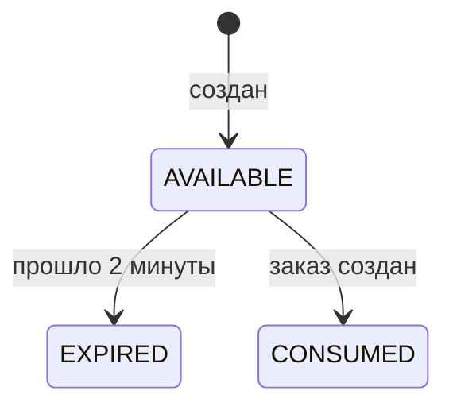
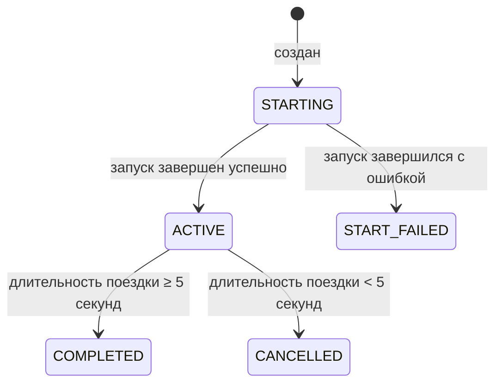

# ADR. Архитектура аренды самокатов

- Статус: proposed
- Дата: 2026-11-05
- Автор: команда 4
- Согласующий: архитектурное ревью

## Контекст и требования

Заготовка хранит заказы в памяти, допускает гонку при старте и не разбирает таймауты внешних вызовов. Требуется использование БД; наличие как минимум двух сервисов (основная логика должна хоститься отдельно от источников и смежных сервисов), эмулятора нагрузки и отчета о тестировании.

**FR:** создавать оффер и проверять его свежесть при старте; создавать заказ, показывать его состояние и текущую стоимость поездки, завершать поездку; очищать заказы по базовому сроку один год с настройкой периода хранения по зоне.

**NFR**: Maintainability — микросервисная архитектура, тестируемость; Reliability — идемпотентность, отказоустойчивость, кэширование и фоллбэки; Scalability — 100 заказов/с, 5000 чтений/с, горизонтальное масштабирование; Performance — p95 ≤ 2 с; Storage — PostgreSQL, очистка по сроку зоны; Observability — метрики, логи, графики.

| Параметр нагрузки команды 4 | Значение |
| --- | ---: |
| Создание заказов | 100/с |
| Просмотры на заказ | 50 |
| Размер записи заказа | около 1 КБ |

При 100 заказах/с и 50 просмотрах на заказ получаем около 5 000 чтений/с. Для расчета продовой конфигурации считаем эту нагрузку постоянной.

Допущения:

- Rental — единственная система, которая может выдавать самокаты в аренду.

## Решение

- Основная логика аренды находится в Rental: он управляет офферами, заказами и занятостью самокатов.
- Состояние Rental хранится в PostgreSQL. Транзакции и ограничения БД обеспечивают согласованные переходы состояний и не допускают двойной аренды.
- Старт асинхронный: API в одной транзакции создает заказ `STARTING` и задачу START, затем возвращает `order_id`.
- API может закрыть старт с истекшим `STARTING` и принять новый для того же самоката.
- Задачи Rental хранятся в PostgreSQL без брокера и выполняются с семантикой at-least-once. Payment защищает денежные операции по `operation_id`.
- Внешние HTTP-вызовы выполняем без открытой транзакции `rental_db`, чтобы не удерживать блокировки строк во время ожидания ответа.
- Maintenance worker удаляет завершенные задачи и переносит заказы в `orders_history`, разделенную по `delete_after`, чтобы очищать историю целыми разделами.

## Роли сервисов

| Сервис | Роль в проекте | Данные |
| --- | --- | --- |
| Rental | Основная логика: офферы, заказы, занятость самокатов, цена, фоновые задачи и очистка | PostgreSQL (`rental_db`) |
| Source | Заглушка API scooters, tariff-zones, users и configs | Данные в памяти |
| Payment | Заглушка платежного API для Rental | Состояние команд в памяти, теряется при перезапуске |

Подробно проектируем Rental. Заглушки реализуют согласованный API и позволяют проверять реакции Rental на ответы, таймауты и ошибки.

### Source

| Метод и вход | Ответ `200` |
| --- | --- |
| `GET /scooter/{id}`; `id`: строка | `id`, `zone_id`: строки; `charge`: целое число от 0 до 100 |
| `GET /tariff-zone/{id}`; `id`: строка зоны | `id`: строка; `price_per_minute`, `price_unlock`, `default_deposit`: целые неотрицательные суммы |
| `GET /user-profile/{id}`; `id`: строка пользователя | `id`: строка; `has_subscription`, `trusted`: булевы значения |
| `GET /configs`; без параметров | `price_coeff_settings: {surge, low_charge_discount}`: положительные коэффициенты; `default_retention_days`: положительное целое; `retention_days_by_zone`: словарь `zone_id → положительное целое`; `tariff_zone_cache_ttl_minutes`: положительное целое, по умолчанию 10 |

Неизвестный `id` дает `404`; некорректный запрос — `400`; недоступность источника — `5xx` или таймаут. `zone_id` из ответа scooters используется для запроса tariff-zones.

### Payment

| Метод | Запрос | Ответ `200` | Описание |
| --- | --- | --- | --- |
| `POST /payments/hold` | `operation_id`, `user_id`: строки; `amount`: положительная целая сумма; `hold_expires_at`: время UTC | `status: success` или `failed` | Удерживает сумму до `hold_expires_at`. `success` — удержание создано; `failed` — удержания нет. После VOID или при уже истекшем `hold_expires_at` первый HOLD возвращает `failed`. |
| `POST /payments/settle` | `operation_id`, `user_id`: строки; `total_amount`: целая неотрицательная сумма | `status: success` или `failed` | Принимает итоговую сумму и без HOLD; истекшее удержание не учитывает. Завершает действующее удержание и освобождает остаток. `success` — полная оплата (`PAID`); `failed` — неполная оплата (`DEBT`). |
| `POST /payments/void` | Только `operation_id`: строка | `status: success` | Отменяет удержание и запрещает поздний первый HOLD. Допустим до HOLD и после отказа HOLD. `success` возвращается и при отсутствующем или истекшем удержании. Временный сбой — `5xx` или таймаут; он не сохраняется как окончательный отказ. |
| `GET /payment/{id}` | `id`: `operation_id` | `status: HELD`, `HOLD_FAILED`, `HOLD_EXPIRED`, `PAID`, `DEBT` или `VOIDED`; до первой команды — `404` | Читает состояние платежного цикла без изменений. |

- `operation_id` идентифицирует платежный цикл; Rental передает в нем свой `order_id`.
- Первый HOLD или SETTLE связывает `operation_id` с `user_id`; другой `user_id` при следующих вызовах дает `409 USER_MISMATCH`.
- После VOID новый SETTLE, а после SETTLE новый HOLD или VOID отклоняются с `409`. Для другого действия с тем же `operation_id` Payment проверяет допустимый порядок.
- Каждое действие выполняется не более одного раза для данного `operation_id`. Повтор того же метода с теми же параметрами возвращает сохраненный окончательный результат без нового денежного эффекта: `success` или `failed` для HOLD/SETTLE, `success` для VOID; измененные параметры дают `409 PARAMETER_CONFLICT`.
- Некорректный запрос дает `400`, нарушение порядка — `409`.

## Сценарии

### Сущности и инварианты

#### Оффер

Оффер фиксирует денежные условия для конкретного пользователя и самоката.

- Оффер хранит рассчитанные при создании `minute_rate`, `unlock_fee`, `deposit`, а также исходные `zone_id` и `charge` самоката. `user_profile_fallback_used` отмечает применение fallback при отказе users. Обновление тарифа, config или профиля не меняет условия оффера.
- На один самокат могут существовать офферы разных пользователей.
- Новый заказ создается только по `AVAILABLE` до `expires_at`. При старте `zone_id` и результат `is_low_charge(charge)` у самоката должны совпасть с данными оффера (см. «Расчет цены и депозита»); точный заряд может отличаться. Один оффер создает не более одного заказа.

#### Заказ

Заказ связывает пользователя, самокат и оффер; хранит состояние поездки и её стоимость.

- Для одного самоката существует не более одного заказа в `STARTING` или `ACTIVE`.
- `STARTING` может перейти в `ACTIVE` только до `deadline_at`. При активации один раз фиксируется `started_at`.
- Завершить можно только `ACTIVE`. Поездка короче 5 секунд имеет нулевую стоимость.
- В `STARTING` стоимость — `null`, в `START_FAILED` — ноль, в `ACTIVE` рассчитывается при чтении, после завершения фиксируется.

### Клиентские операции

HTTP/JSON: идентификаторы — строки, время — UTC, суммы — целые числа. Ошибки содержат `error_code`: `400 INVALID_REQUEST`, `404 NOT_FOUND`, `409 PARAMETER_CONFLICT / OFFER_EXPIRED / OFFER_CHANGED / SCOOTER_BUSY / ORDER_NOT_ACTIVE`, `503 SOURCE_UNAVAILABLE / ZONE_STALE`. Поля времени до соответствующего события равны `null`.

| Операция и вход | Действие Rental | Ответ | Повтор |
| --- | --- | --- | --- |
| `POST /offers`: scooter_id, user_id, idempotency_id | Читает Source, рассчитывает и сохраняет денежные условия и срок действия оффера. | `201 {offer_id, minute_rate, unlock_fee, deposit, expires_at}`; повтор — `200` | Пока оффер хранится, повтор с тем же `idempotency_id` и параметрами возвращает прежний результат; другие параметры дают конфликт. |
| `POST /orders`: offer_id | 1. Ищет заказ по `offer_id` для быстрого ответа на повтор. 2. Получает в Source текущие `zone_id` и `charge` самоката. 3. Начинает транзакцию. После блокировки нужных записей повторно ищет заказ по `offer_id`, проверяет статус `AVAILABLE` и срок оффера, зону и условие `is_low_charge(charge)`, затем занятость самоката. 4. Если прежний `STARTING` просрочен, в этой же транзакции закрывает его как `START_FAILED` с записью `closed_at`. Переводит выбранный оффер в `CONSUMED`, создает заказ `STARTING` с условиями оффера и задачу START. Фиксирует транзакцию. | `202 {order_id, status: STARTING}`; повтор — `200 {order_id, status}` с текущим статусом | Если заказ по `offer_id` уже существует, Rental возвращает его `order_id` и текущий статус без создания нового заказа. |
| `GET /orders/{order_id}` | Читает заказ и при необходимости рассчитывает стоимость | `200 {order_id, status, cost, started_at, finish_time}`; после очистки — `404` | — |
| `POST /orders/{order_id}/finish`; без тела | При первом завершении в одной транзакции фиксирует время, стоимость и конечный статус заказа, создает задачу SETTLE | `200 {order_id, status, finish_time, cost}` | Повтор возвращает зафиксированный результат. |

### Фоновые задачи

| Статус задачи | Значение |
| --- | --- |
| `PENDING` | Ожидает попытки или выполняется worker с действующим lease |
| `COMPLETED` | Результат записан; задача выполнена и ждет удаления maintenance worker |
| `DEAD_LETTER` | Автоматические попытки остановлены; требуется ручное восстановление |

| Задача | Когда создается | Обычная попытка worker | Когда исчерпан `max_attempts` |
| --- | --- | --- | --- |
| START | API создает заказ `STARTING` | 1. Проверяет заказ и дедлайн. Если заказ уже `START_FAILED`, завершает задачу с причиной `DEADLINE_EXCEEDED`. Если дедлайн истек при `STARTING`, переводит заказ в `START_FAILED` и завершает задачу с той же причиной. В обоих случаях создает VOID при положительном депозите. 2. Иначе при положительном депозите вызывает `POST /payments/hold`. 3. При нулевом депозите или `success` от HOLD переводит заказ в `ACTIVE`. Явный `failed` переводит заказ в `START_FAILED` без VOID. | Завершает START без нового HOLD: до дедлайна — с `MAX_ATTEMPTS_EXCEEDED`, после дедлайна или если API уже закрыл заказ — с `DEADLINE_EXCEEDED`. При необходимости переводит заказ в `START_FAILED` и создает VOID при положительном депозите. |
| SETTLE | API завершает поездку | Вызывает `POST /payments/settle`. `success` или `failed` завершают задачу; `failed` означает долг в Payment. | Переводит задачу в `DEAD_LETTER`. |
| VOID | При закрытии неудачного START с положительным депозитом, кроме явного `failed` от HOLD при еще `STARTING` | Вызывает `POST /payments/void`. `success` завершает задачу. | Переводит задачу в `DEAD_LETTER`. |

Сумму для HOLD и условие создания VOID worker берёт из неизменяемого `orders.deposit`.

Для неудачного START `completion_reason` принимает `PAYMENT_REJECTED`, `DEADLINE_EXCEEDED`, `MAX_ATTEMPTS_EXCEEDED` или `CONTRACT_ERROR`; при успешном старте поле пустое. `last_error` хранит последнюю техническую ошибку вызова, если она была.

Несколько worker выбирают задачи в `PENDING` из общей таблицы PostgreSQL через `FOR UPDATE SKIP LOCKED`. Захват происходит отдельной короткой транзакцией только над `tasks`. При захвате для обычной попытки назначаются новый `claim_id` и `lease_until`, увеличивается `attempt_count`.

- Для попытки требуется `next_run_at <= now` и отсутствие действующего lease. Задача с исчерпанным `max_attempts` при отсутствии действующего lease доступна независимо от `next_run_at` для завершения по столбцу «Когда исчерпан max_attempts», без увеличения `attempt_count`.
- Для обычных попыток START `next_run_at` и `lease_until` не выходят за дедлайн; `deadline_at = task.created_at + 2 минуты`. При создании START сохраняется `hold_expires_at = deadline_at + 1 час`; повторы его не меняют.
- Перед записью результата обычной попытки worker в одной транзакции проверяет актуальные `claim_id`, действующий lease и состояние задачи. Повтор внешнего вызова безопасен благодаря идемпотентности Payment. Повторы используют прежние параметры и `operation_id`.
- Просроченный START закрывается независимо от `next_run_at` и прежнего lease. В одной транзакции под блокировками повторно проверяются состояния задачи и заказа и наступление дедлайна по `clock_timestamp()`, аннулируется `claim_id`; незавершенный START получает `COMPLETED` с `DEADLINE_EXCEEDED`, заказ при необходимости — `START_FAILED`, создается VOID при положительном депозите.
- При временной ошибке worker записывает `last_error` и назначает `next_run_at` с exponential backoff, jitter и максимальной задержкой, если позволяют `max_attempts` и дедлайн.

При завершении задачи worker в одной транзакции ставит `COMPLETED`, записывает `finished_at`, результат и `completion_reason`, если он есть; в той же транзакции при необходимости меняет заказ и создает следующую задачу.

SETTLE и VOID сохраняют параметры вызова для безопасных повторов.

Логическая DLQ — статус `DEAD_LETTER` в `tasks`: задача остается незавершенной, автоматические повторы остановлены. После устранения причины ее вручную возвращают в `PENDING` со сбросом `attempt_count`, `claim_id` и `lease_until`, назначается новый `next_run_at`.

### Основной поток

| Событие | Оффер после события | Заказ после события |
| --- | --- | --- |
| API: создание оффера | AVAILABLE | — |
| API: запрос старта | CONSUMED | STARTING |
| API: закрытие просроченного старта | CONSUMED | START_FAILED |
| Worker: START успешен | CONSUMED | ACTIVE |
| Worker: START не удался | CONSUMED | START_FAILED |
| API: завершение поездки | CONSUMED | COMPLETED или CANCELLED |

- Lease закрепляет задачу за worker, но API может самостоятельно закрыть просроченный `STARTING`. Для предотвращения конкуренции API и worker блокируют заказ и повторно проверяют его статус, `deadline_at` задачи и текущее время БД через `clock_timestamp()`. Результат другого участника не перезаписывается.

### Расчет цены и депозита

При создании оффера Rental рассчитывает `minute_rate`, `unlock_fee` и `deposit` из данных Source. При старте копирует их в заказ. В формулах `t` — длительность от `started_at` до текущего времени БД при просмотре или до `finish_time` при завершении.

~~~text
is_low_charge(charge) = charge < 28
offer.minute_rate = floor(tariff.price_per_minute × config.surge)
если is_low_charge(scooter.charge): offer.minute_rate = floor(offer.minute_rate × config.low_charge_discount)
offer.deposit = 0, если user.trusted; иначе tariff.default_deposit
offer.unlock_fee = 0, если user.has_subscription; иначе tariff.price_unlock
cost(t) = 0, если t < 5 секунд
cost(t) = order.unlock_fee + floor(floor(t в секундах) × order.minute_rate / 60), иначе
order.cost = cost(t) при завершении поездки
~~~

При завершении Rental фиксирует `order.cost` и передает эту сумму в SETTLE, включая ноль. При нулевом депозите HOLD не вызывается.

## Сбои

Поведение при отказе источников:

| Источник | Поведение Rental при сбое |
| --- | --- |
| scooters | Не создавать оффер и не начинать новый заказ без актуальных данных самоката; действующую поездку можно завершить |
| payments | При `5xx` или таймауте исход команды неизвестен Rental. START ограничен дедлайном и числом попыток; действующую поездку можно завершить, SETTLE и VOID повторяются до лимита, затем ждут разбора в DLQ |
| configs | Кэш обновляется раз в минуту. При отказе используем последнее валидное значение, при холодном запуске — значения по умолчанию. По нему рассчитываем `delete_after` новых завершенных заказов; архивация и очистка идут по сохраненным срокам |
| tariff-zones | LRU-кэш со сроком `tariff_zone_cache_ttl_minutes` из config, по умолчанию 10 минут; просроченные данные недействительны, вернуть ошибку |
| users | При таймауте/5xx считать, что подписки нет и пользователь не trusted: полный депозит и полная цена разблокировки; 404 — ошибка |

Неожиданный `4xx` от Payment означает ошибку контракта или данных. При действующем claim и до дедлайна START завершается с причиной `CONTRACT_ERROR`: заказ становится `START_FAILED`, при положительном депозите создается VOID. SETTLE или VOID переходят в `DEAD_LETTER` с оповещением; после исправления причины их вручную возвращают на выполнение.

## Хранение данных

Минимальная модель и индексы для основных запросов:

| БД и запись | Что хранит | Ограничение или индекс |
| --- | --- | --- |
| rental_db.offers | `minute_rate`, `unlock_fee`, `deposit`, `zone_id`, `charge`, `user_profile_fallback_used`, idempotency_id, expires_at | Уникальные offer_id и idempotency_id; поиск истекших офферов по expires_at |
| rental_db.orders | `minute_rate`, `unlock_fee`, `deposit`, `zone_id` из оффера; состояние заказа, `started_at`, `closed_at`, `delete_after` | Уникальные `order_id` и `offer_id`; уникальный `scooter_id` для `STARTING` и `ACTIVE`; индекс по `delete_after` для завершенных заказов |
| rental_db.orders_history | Завершенные заказы после выполнения задач: `order_id`, `offer_id`, пользователь, самокат, зафиксированные условия, `user_profile_fallback_used` из оффера, статус, время, стоимость и `delete_after` | Недельные разделы по `delete_after`; локальные индексы по `order_id`, `offer_id` и `delete_after` |
| rental_db.tasks | `order_id`, тип задачи (START, SETTLE или VOID), параметры вызова, статус, результат, `completion_reason`, `finished_at`, число попыток, `claim_id`, `next_run_at`, `lease_until`, дедлайн START и `last_error` | Уникальная пара (`order_id`, тип задачи); индексы (`next_run_at`, `task_id`) для `PENDING`, (`deadline_at`, `task_id`) для незавершенных START, (`finished_at`, `task_id`) для `COMPLETED` |

### Заказы и история

Новый заказ создается в `orders`. Только эта таблица содержит `STARTING` и `ACTIVE`, поэтому ограничение на одну действующую аренду самоката остается локальным. Завершенный заказ с незавершенной задачей, включая `DEAD_LETTER`, остается в `orders` до ее завершения даже после `delete_after`.

GET по `order_id` сначала ищет `orders`, затем все разделы `orders_history` по их индексам. Повтор старта по `offer_id` ищет заказ тем же способом после удаления оффера. Уникальность `order_id` в истории обеспечивает Rental: он создает уникальные ID и переносит каждый заказ только один раз.

### Очистка данных

При переходе заказа в конечное состояние Rental фиксирует `closed_at`: для `COMPLETED` и `CANCELLED` это `finish_time`, для `START_FAILED` — `failed_at`. Тогда же рассчитывает `delete_after` по config; базовый срок — 365 дней.

~~~text
delete_after = closed_at + retention_days_by_zone.get(order.zone_id, default_retention_days)
~~~

Maintenance worker внутри Rental запускается раз в минуту. Он удаляет задачи `COMPLETED` из `tasks`, затем переносит завершенные заказы без записей в `tasks` в `orders_history` и удаляет их из `orders` вместе с оффером в одной транзакции. При переносе копирует `user_profile_fallback_used` из связанного оффера. Заказы с уже истекшим `delete_after` удаляются без переноса.

Запуски maintenance worker координируем lease в PostgreSQL.

Maintenance worker удаляет истекшие офферы без заказа и целые разделы `orders_history`, когда срок истек для всех их записей. Из-за недельных разделов заказ может храниться до недели сверх `delete_after`. Удаление разделов выполняется через [`DETACH PARTITION CONCURRENTLY`](https://www.postgresql.org/docs/current/sql-altertable.html), затем `DROP TABLE`. После сбоя worker завершает прерванное отсоединение через `FINALIZE` и удаляет оставшиеся отсоединенные таблицы.

## Нагрузка и бюджет ресурсов

Rental API можно запускать в нескольких экземплярах без привязки клиента к экземпляру: заказы и состояние фоновой работы находятся в PostgreSQL, локальные кэши config и tariff-zones можно восстановить. Каждый экземпляр использует ограниченный пул соединений с PostgreSQL; суммарный лимит учитывает API, worker и перенос истории.

Оценка запросов при постоянной продовой нагрузке и исправных зависимостях, без повторов:

| Сервис | Операции | Запросов/с |
| --- | --- | ---: |
| Rental | Оффер / старт / просмотр / завершение | 100 / 100 / 5 000 / около 100 |
| Source | Самокат при оффере и старте / пользователь при оффере | около 200 / 100 |
| Source | Тарифная зона / конфигурация | До 100/с при промахах кэша / один раз в минуту на экземпляр Rental |
| Payment | HOLD при deposit > 0 / SETTLE для всех заказов | Не более 100/с / около 100/с при исправной зависимости |

При 100 новых заказах/с очередь получает 100 задач START/с независимо от депозита; VOID добавляется при неудачных стартах с положительным депозитом. Параллелизм worker ограничиваем, а отставание обработки измеряем.

### CPU

**Методика.** Для Rental измеряем процессорное время каждого типа запроса и фоновой задачи при заданном RPS. Оценка числа ядер: `vCPU = Σ(RPS операции × CPU-секунды операции) / целевая загрузка`. PostgreSQL измеряем и рассчитываем отдельно.

**Гипотеза.** Для Rental принимаем 1 мс CPU на просмотр, 2 мс на каждую из 300 клиентских операций/с, 2 мс на каждую из примерно 200 задач/с и еще 0,3 CPU-секунды/с на maintenance worker. Получаем `5 000 × 1 мс + 300 × 2 мс + 200 × 2 мс + 0,3 с = 6,3 CPU-секунды/с`. При целевой загрузке 70% нужно 9 vCPU; для продовой конфигурации предварительно закладываем 12 vCPU на четыре экземпляра Rental.

Для PostgreSQL предполагаем, что 70% просмотров читают `orders`, а 30% — годовую `orders_history`: 3 500 и 1 500 запросов/с. Принимаем 0,5 мс CPU на чтение текущего заказа, 4 мс на исторический поиск и еще 2 CPU-секунды/с на записи и архивацию. Поиск по `order_id` проверяет все недельные разделы. Получаем `5 000 × (0,7 × 0,5 мс + 0,3 × 4 мс) + 2 с = 9,75 CPU-секунды/с`. При целевой загрузке 70% нужно около 14 vCPU; для продовой конфигурации предварительно закладываем 16 vCPU. Доля исторических чтений и затраты CPU — допущения, которые проверяем на истории годового объема.

### RAM

**Методика.** Отдельно оцениваем пик памяти каждого экземпляра Rental с worker и локальными кэшами, число экземпляров и память PostgreSQL: общий буфер, рабочую память запросов и соединений. Пулы соединений ограничиваем так, чтобы сумма соединений API и фоновых обработчиков укладывалась в лимит PostgreSQL. Память для файлового кэша ОС и запас под пики учитываем при выборе конфигурации узлов.

**Гипотеза.** RAM зависит от запросов, кэшей и параллелизма. Для четырех экземпляров Rental предполагаем пик 1,5 ГиБ на экземпляр с кэшами и worker: `4 × 1,5 = 6 ГиБ`. Выделяем по 2 ГиБ на экземпляр, всего 8 ГиБ.

Для PostgreSQL предполагаем 16 ГиБ общих буферов, 32 ГиБ файлового кэша ОС, до 100 активных соединений по 32 МиБ и 4 ГиБ для прочей работы: `16 + 32 + 100 × 32 / 1024 + 4 ≈ 55 ГиБ`. Предварительно закладываем 64 ГиБ. Пик RSS Rental, память соединений и долю чтений с диска проверяем под нагрузкой.

### Disk Space

**Методика.** Объем истории считаем как `число заказов за срок хранения × измеренный размер записи с индексами`. Добавляем место под текущие заказы и задачи и дополнительное обслуживание PostgreSQL; резервные копии учитываем отдельно. Проверяем скорость удаления завершенных задач, архивации заказов и удаления разделов: после выхода на срок хранения освобождаться должно не меньше места, чем поступает. Для худшего пути GET отдельно измеряем число чтений с диска и задержку на годовой истории.

**Гипотеза.** При постоянных 100 заказах/с и базовом сроке 365 дней создается `100 × 86 400 × 365 ≈ 3,15 млрд` заказов, или 3,15 ТБ при заданном размере 1 КБ без индексов. Предполагаем 2 КБ на историческую запись с индексами: около 6,3 ТБ. Недельный раздел добавляет до 0,12 ТБ перед удалением. Еще 0,5 ТБ предполагаем на дополнительное обслуживание БД. Итого около 6,9 ТБ; с запасом около 20% предварительно закладываем 9 ТБ основного хранилища. Более долгий срок по зоне, дополнительные VOID и резервные копии увеличивают потребность.

### Бюджет ресурсов

| Ресурс | Расчет по гипотезе | Предварительный продовый бюджет |
| --- | ---: | ---: |
| CPU Rental | 6,3 CPU-секунды/с; 9 vCPU при загрузке 70% | 12 vCPU: 4 экземпляра по 3 |
| CPU PostgreSQL | 9,75 CPU-секунды/с; около 14 vCPU при загрузке 70% | 16 vCPU |
| RAM Rental | 4 × 1,5 ГиБ = 6 ГиБ | 4 × 2 ГиБ = 8 ГиБ |
| RAM PostgreSQL | Около 55 ГиБ | 64 ГиБ |
| Disk Space PostgreSQL | Около 6,9 ТБ без резервных копий | 9 ТБ |

Перед продовым запуском расчет нужно проверить на данных годового объема при 100 новых заказах/с и 5 000 просмотрах/с с долями 70% текущих и 30% исторических заказов, одновременно с работой worker, переносом и очисткой. Сценарий, в котором все просмотры обращаются к годовой истории, проверяется отдельно. Измеряем CPU, RAM, чтения с диска и p95 исторического GET. Если цель по чтению не достигается, проверяем план запроса и при необходимости пересматриваем способ поиска в истории.

## Альтернативы и последствия

| Требование | Выбранное решение | Альтернативы |
| --- | --- | --- |
| Согласованно начать заказ из оффера | Оффер, заказ и задача START принадлежат Rental и меняются в одной транзакции. | Разделение офферов и заказов по сервисам потребует межсервисной координации при старте. |
| Не допустить двух действующих заказов на самокат | Занятость определяется по `orders`; ограничение БД допускает только один `STARTING` или `ACTIVE` на `scooter_id`. | Отдельная запись занятости в Rental дублирует состояние заказа, а перенос ее в Source потребует межсервисной координации. |
| Сохранять состояние и очищать историю по сроку | PostgreSQL хранит текущие заказы и задачи; разделы истории по `delete_after` позволяют удалять истекшие записи. | Память процесса теряет данные при перезапуске. Redis позволяет сохранять данные, но связи и правила архивации пришлось бы в большей степени реализовать в Rental. |
| Не терять фоновые задачи | Задача создается в PostgreSQL в одной транзакции с заказом. | Отдельному брокеру потребовался бы механизм надежной доставки задачи из БД. |
| Читать архивный заказ по `order_id` | Поиск по индексам разделов истории; его задержку проверяем на годовом объеме. | `order_locator` ускорил бы поиск, но добавил запись на каждый заказ и собственную очистку. |
| Обслуживать просмотры заказов | Сначала читаем из БД и проверяем задержку под нагрузкой. | Кэш чтений отложен: для меняющихся заказов потребуется инвалидизация. |

### Объем данных и выбор PostgreSQL

Заложенные 9 ТБ диска не превышают формальные ограничения PostgreSQL: согласно [документации](https://www.postgresql.org/docs/current/limits.html), размер базы не имеет фиксированного верхнего предела, а предел отдельного отношения при стандартном размере блока — 32 ТБ. Производительность выбранного поиска по разделам проверяется нагрузочным тестом.

Исторический поиск без `delete_after`, пропускная способность диска, архивация и восстановление требуют проверки на полном объеме данных. При росте БД пересчитываем бюджет диска и повторяем нагрузочное тестирование; текущие 9 ТБ рассчитаны только для базового срока хранения и принятых допущений.

### Последствия и риски

- При недоступном VOID удержание после неудачного старта сохраняется до `hold_expires_at`. Во время долгой поездки HOLD может истечь; сбой Payment задерживает SETTLE.
- Очередь может задержать старт с нулевым депозитом. Одновременные старты одного самоката вызывают конфликты.
- Новые офферы могут рассчитываться по прежним коэффициентам, пока Rental не получит обновленный `config`.
- Рост истории заказов увеличивает объем хранения и может замедлить поиск по разделам.

## Наблюдаемость

| Область | Метрики |
| --- | --- |
| API | RPS, ошибки и p95 по операциям; исторический GET отдельно |
| Внешние зависимости | Ошибки и таймауты Source и Payment |
| Старт и фоновые задачи | Число заказов в `STARTING`; p95 от создания заказа до `ACTIVE` для успешных стартов; доля и число неудачных стартов по `completion_reason`; время ожидания и выполнения задач; задачи по типу и статусу; истекшие lease; число и возраст задач в DLQ |
| Архивация и очистка | Число задач `COMPLETED` в `tasks` и заказов `COMPLETED`, `CANCELLED`, `START_FAILED` в `orders`, возраст старейшей записи каждого вида; отставание удаления задач, переноса заказов и очистки истории; число и длительность удалений разделов, объем удаленных записей; состояние maintenance worker |
| Ресурсы | CPU и RAM экземпляров Rental и PostgreSQL; размер БД и индексов; число соединений с PostgreSQL |

Попадание задачи в DLQ и устойчивый рост очереди или отставания архивации вызывают оповещение.

Worker записывает в структурированный журнал завершение задачи с `task_id`, `order_id`, типом, результатом, числом попыток, `completion_reason` и `last_error`. Журнал используют для разбора завершенных задач после их удаления из `tasks`.

## Проверка

| Показатель базового нагрузочного прогона при исправных зависимостях | Цель |
| --- | ---: |
| Офферы и старты заказов | 100/с каждого типа |
| Завершения в установившемся режиме | около 100/с |
| Просмотры заказов | около 5 000/с |
| Просмотр заказа, p95 | ≤ 300 мс |
| Создание оффера, p95 | ≤ 1 с |
| Начало заказа (ответ API), p95 | ≤ 2 с |
| Завершение заказа (ответ API), p95 | ≤ 2 с |
| Переход `STARTING → ACTIVE` для успешно активированных заказов, p95 | ≤ 2 с |

На учебном стенде проверяем все FR. В базовом и отдельном смешанном нагрузочном прогоне после разогрева измеряем 30 минут работы при исправных зависимостях. За окно замеров создается около 180 тысяч заказов. Цели по RPS и p95 из таблицы относятся к этим окнам; во всех сценариях ожидаем ноль двойных аренд и списаний.

Время перехода `STARTING → ACTIVE` считаем только для успешных активаций в окне замеров. Отдельно считаем долю неудачных стартов: число заказов, созданных в этом окне и дошедших до `START_FAILED`, делим на число всех созданных в нем заказов. Итоговую долю и причины считаем после завершения оставшихся поездок и задач; незавершенные `STARTING` показываем отдельно.

Если в сценарии не указано иное, `GET /configs` возвращает:

| Параметр | Значение |
| --- | ---: |
| `price_coeff_settings.surge` | `1.25` |
| `price_coeff_settings.low_charge_discount` | `0.8` |
| `default_retention_days` | `365` |
| `retention_days_by_zone` | `{}` |
| `tariff_zone_cache_ttl_minutes` | `10` |

### Базовый нагрузочный прогон

**Исходные данные.** Source заранее содержит:

| API | Объем данных |
| --- | --- |
| scooters | 40 000 самокатов с устойчивыми ID, поровну в четырех зонах; заряд по обе стороны порога 28 |
| users | 40 000 профилей с разными значениями `has_subscription` и `trusted` |
| tariff-zones | Четыре тарифные зоны |
| configs | Одна действующая конфигурация |

При 100 стартах/с и максимальной длительности 6 минут одновременно заняты до `100 × 360 = 36 000` самокатов; еще 4 000 остаются для заказов в `STARTING` и запаса. Payment начинает с пустым состоянием операций; в базовом прогоне HOLD и SETTLE возвращают `success`. Эмулятор назначает пользователю и самокату не больше одной поездки одновременно; после завершения их ID используются снова.

**Алгоритм.**

1. Начинаем с пустой `rental_db`. Эмулятор создает 100 новых аренд в секунду независимо от времени ответа; длительность поездки выбирает равномерно от 4 до 6 минут с фиксированным seed. На каждую поездку приходится 50 просмотров, равномерно распределенных по ее длительности.
2. Разогреваем стенд не менее 6 минут. Замеры начинаем, когда средние за минуту RPS офферов, стартов, просмотров и завершений находятся в пределах ±5% от целей, а отставание фоновых задач не растет.
3. Измеряем 30 минут. Во время прогона работают worker, удаление завершенных задач и перенос заказов в историю.
4. После 30 минут прекращаем создание новых аренд. Запланированные просмотры и завершения уже начатых поездок продолжаются; дожидаемся завершения этих поездок и их фоновых задач.

**Проверяем.** Создание оффера, асинхронный старт, просмотр статуса и текущей стоимости, формулы цены и депозита, завершение, перенос в историю и показатели из таблицы выше.

**Ожидаем.**

- Достигаются указанные RPS и p95; неожиданных ошибок операций и `START_FAILED` нет. После завершения поездок и обработки очереди не остается `STARTING`.
- В `STARTING` стоимость не определена, в `ACTIVE` она рассчитывается при чтении, завершение фиксирует ее.
- Цена и депозит соответствуют формулам.
- Завершенные задачи удаляются, заказы переносятся в историю с `delete_after`, рассчитанным по базовому config; отставание очистки и переноса не растет.
- Двойных аренд и списаний нет.

### Смешанный прогон с историей

Предварительно загружаем доступный стенду объем истории во все недельные разделы годового диапазона. На фоне 100 новых заказов и около 100 завершений/с задаем 3 500 просмотров текущих и 1 500 просмотров исторических заказов/с; исторические ID выбираем равномерно. После разогрева измеряем 30 минут одновременно с обработкой задач, переносом и очисткой. Проверяем цели RPS и p95, отсутствие ошибок и роста отставания. Отчет указывает фактические число строк, размер истории, число разделов, CPU, RAM и чтения с диска. Результат относится к проверенному объему; расчет на 3,15 млрд заказов требует отдельной проверки.

### Офферы и конкурентный старт

**Алгоритм.**

1. Повторяем создание оффера с тем же `idempotency_id` и прежними, затем измененными параметрами; меняем тариф и профиль после создания оффера, начинаем заказ до истечения срока и отдельно пытаемся начать истекший оффер.
2. Создаем несколько действующих офферов на один самокат, одновременно начинаем заказы по ним и повторяем старт по одному `offer_id`.

**Проверяем.** Свежесть оффера, идемпотентность создания, один заказ на оффер и ограничение занятости самоката.

**Ожидаем.**

- Точный повтор оффера возвращает прежний результат; измененные параметры дают конфликт.
- Условия созданного оффера не меняются после обновления тарифа или профиля; истекший оффер не создает заказ.
- Один самокат имеет не более одного `STARTING` или `ACTIVE`; повтор старта по офферу возвращает тот же заказ.

### Нулевой депозит и просроченный старт

**Алгоритм.**

1. В двух запусках создаем заказ с нулевым депозитом: worker обрабатывает START до дедлайна и после него.
2. Для заказа с положительным депозитом дожидаемся просроченного `STARTING`: клиентский API закрывает его и создает новый заказ на тот же самокат. После этого worker обрабатывает старую задачу START.

**Проверяем.** Единый способ создания задачи START, закрытие просроченного заказа без изменения его задачи и освобождение самоката для нового старта.

**Ожидаем.**

- При нулевом депозите START не вызывает HOLD: до дедлайна заказ становится `ACTIVE`, после дедлайна — `START_FAILED` без VOID.
- API атомарно закрывает старый заказ и создает новый.
- Старая задача остается до обработки worker, который завершает ее и создает один VOID при положительном депозите.

### HOLD, VOID и потерянные ответы

**Алгоритм.**

1. После успешного HOLD прерываем Rental до записи `ACTIVE`. Отдельно теряем ответ Payment на HOLD и повторяем вызов без предварительного GET.
2. Задерживаем HOLD до и после VOID; теряем ответ на VOID и повторяем его. Затем делаем VOID недоступным до `hold_expires_at`.

**Проверяем.** Восстановление старта, повторы по прежнему `operation_id` и освобождение удержания после неудачного старта.

**Ожидаем.**

- Повтор HOLD не создает второго удержания.
- До дедлайна START может завершиться активацией; после дедлайна заказ остается `START_FAILED` и создается VOID.
- VOID отменяет прежний HOLD и запрещает поздний первый HOLD; повтор VOID не меняет результат.
- При недоступном VOID удержание прекращается по `hold_expires_at`.

### Захват задач и гонки с API

**Алгоритм.**

1. Даем последней разрешенной попытке START успешный ответ, затем отдельно прерываем worker во время такой попытки и дожидаемся истечения lease.
2. Задерживаем ответ HOLD до истечения дедлайна и lease; другой worker закрывает просроченный START. Затем даем прежнему worker с устаревшим `claim_id` записать поздний ответ.
3. Пока worker выполняет последнюю попытку START, API закрывает просроченный заказ; повторяем гонку для ответа, ошибки и падения worker.

**Проверяем.** Приоритет дедлайна, запрет новых попыток после лимита, право worker на запись и атомарность завершения задачи с изменением заказа.

**Ожидаем.**

- Успех последней попытки учитывается до дедлайна; после падения worker задача завершается без нового HOLD.
- Истекший START обрабатывается независимо от `next_run_at` и lease; старый `claim_id` не меняет состояние.
- Если API уже закрыл заказ, worker не возвращает его в `ACTIVE`, завершает START один раз и создает один VOID при положительном депозите.
- Запись `COMPLETED` и нужные изменения заказа выполняются в одной транзакции.

### Завершение поездки и SETTLE

**Алгоритм.**

1. Завершаем заказ без HOLD, затем заказ после истечения HOLD; отдельно завершаем поездку короче 5 секунд с нулевой стоимостью и повторяем запрос на завершение.
2. Возвращаем `failed` на SETTLE, затем имитируем длительный сбой Payment, исчерпание попыток SETTLE и VOID и ручной возврат задач из DLQ.

**Проверяем.** Независимость завершения поездки от расчета в Payment, идемпотентность завершения и возобновление платежных задач.

**Ожидаем.**

- Первый запрос фиксирует статус, время и стоимость заказа; повтор возвращает их без нового SETTLE.
- SETTLE выполняется и без HOLD; истекший HOLD не мешает расчету.
- Поездка короче 5 секунд получает `CANCELLED` и нулевую стоимость; SETTLE освобождает действующее удержание.
- `failed` от SETTLE означает долг в Payment и завершает задачу; при длительном сбое SETTLE или VOID попадает в `DEAD_LETTER`.
- После ручного возврата задача использует прежние параметры и `operation_id`.

### Неожиданные `4xx` от Payment

**Алгоритм.**

1. Возвращаем неожиданный `4xx` на HOLD при положительном депозите.
2. В отдельных запусках возвращаем неожиданный `4xx` на SETTLE и VOID. После исправления причины вручную возвращаем задачи из DLQ.

**Проверяем.** Rental отличает ошибку контракта от временного отказа и не повторяет ошибочный вызов автоматически.

**Ожидаем.**

- `4xx` на HOLD завершает задачу START с причиной `CONTRACT_ERROR`: заказ переходит в `START_FAILED`, создается один VOID; нового HOLD нет.
- При `4xx` на SETTLE или VOID задача переходит в `DEAD_LETTER` с оповещением, статус заказа не меняется.
- После ручного возврата задача использует прежние параметры и `operation_id`.

### Отказы Source и работа кэшей

**Алгоритм.**

1. Вызываем создание оффера и старт при отказе scooters; после создания оффера отдельно меняем зону, заряд без пересечения порога скидки и заряд с пересечением порога.
2. Имитируем таймаут, `5xx` и `404` users; отказ tariff-zones до и после истечения срока кэша; отказ configs при обновлении и холодном запуске. Отдельно меняем `surge` в Source с `1.25` на `1.5`.

**Проверяем.** Проверки при старте, резервный прайсинг и правила кэширования из раздела «Сбои».

**Ожидаем.**

- Без актуальных данных scooters оффер и новый заказ не создаются; изменение зоны или переход заряда через порог скидки запрещает старт, изменение заряда без пересечения порога — нет.
- При таймауте или `5xx` users применяются полная цена разблокировки и полный депозит, в оффере ставится `user_profile_fallback_used`; при `404` возвращается ошибка.
- Просроченный кэш зоны не используется.
- Config обновляется раз в минуту; при отказе применяется последнее валидное значение, при холодном запуске — локальные значения по умолчанию.
- После обновления кэша новые офферы используют `surge = 1.5`, уже созданные сохраняют прежнюю цену.

### Архивация и очистка

**Алгоритм.**

1. Отдельно от базового прогона задаем для `zone-2` срок хранения 30 дней. Создаем завершенные задачи и заказы с датами для проверки сроков 365 и 30 дней, включая заказы с просроченным START и SETTLE/VOID в DLQ. Запускаем maintenance worker при валидном config, затем при недоступном или невалидном config.
2. Заранее загружаем полностью и частично истекшие разделы истории. Во время постоянной нагрузки проверяем чтение по `order_id` и `offer_id` после архивации, удаление целых разделов вместе с параллельными чтениями и переносом; прерываем maintenance worker и запускаем его снова.

**Проверяем.** Порядок удаления завершенных задач и переноса заказов, фиксацию срока заказа при завершении, очистку под нагрузкой и восстановление maintenance worker.

**Ожидаем.**

- Сначала удаляются `COMPLETED` задачи, затем архивируются заказы без записей в `tasks`; в историю копируется `user_profile_fallback_used` из оффера. `STARTING`, `ACTIVE` и заказы с незавершенными задачами, включая `DEAD_LETTER`, остаются в `orders` даже после `delete_after`. Просроченный START закрывает worker по дедлайну; при положительном депозите создается VOID.
- `delete_after` заказа фиксируется при завершении: для `zone-2` — через 30 дней, для других зон — через 365 дней.
- Изменение config не меняет уже сохраненный `delete_after`; записи с истекшим сроком удаляются без переноса.
- После архивации заказ находится по `order_id` и `offer_id` без указателя. Полностью истекший раздел удаляется целиком; частично истекший остается до срока последней записи, поэтому заказ может храниться до недели сверх `delete_after`.
- Удаление раздела не нарушает корректность параллельных чтений и переноса; задержку измеряем.
- При невалидном config `delete_after` новых завершенных заказов рассчитывается по последнему валидному значению или значениям по умолчанию; перенос и очистка продолжаются по уже сохраненным срокам.
- После падения перенос и очистка продолжаются без потери данных; отставание при постоянной нагрузке не растет.
- Исторический поиск измеряем на доступном стенду объеме.

### Отчет

- Для каждого сценария отчет фиксирует начальные условия, шаги, ожидаемый и фактический результат. Для базового и смешанного нагрузочных прогонов дополнительно указывает длительность окна замеров и периода завершения, фактический объем и состав данных, размер БД и индексов, число экземпляров, RPS, p95, ошибки, потребление ресурсов, задержку фоновой обработки, долю и причины неудачных стартов, число оставшихся `STARTING`, отставание переноса и графики метрик.
- Для прогона очистки отдельно фиксирует скорость удаления и задержки параллельных чтений и переноса.
- Для сценариев отказов и гонок приводит последовательность состояний и относящиеся к ним метрики.
