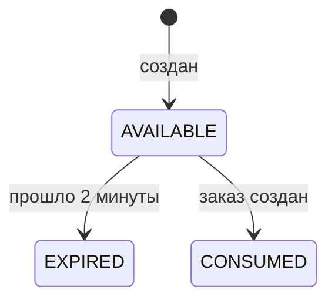
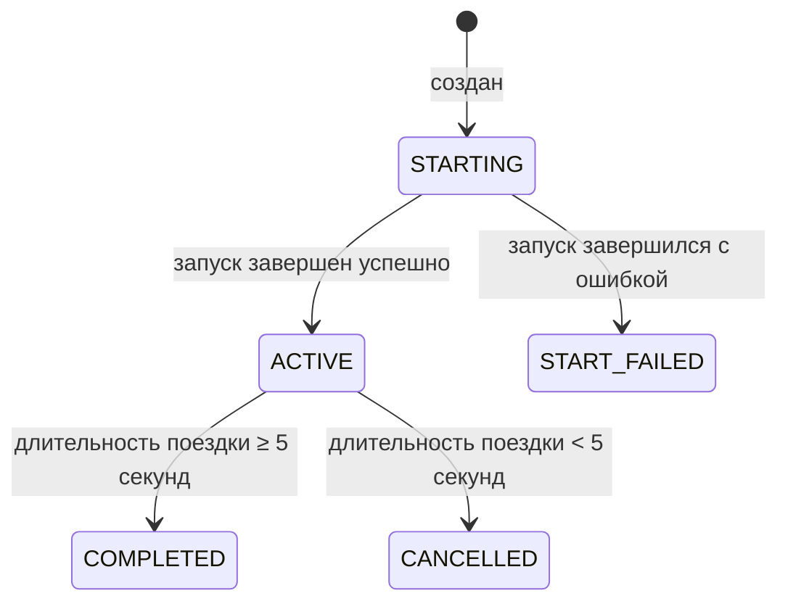

# ADR. Архитектура аренды самокатов

- Статус: proposed
- Дата: 2026-11-05
- Автор: команда 4
- Согласующий: архитектурное ревью

## Контекст и требования

Заготовка хранит заказы в памяти, допускает гонку при старте и не разбирает таймауты внешних вызовов. Требуется использование БД; наличие как минимум двух сервисов (основная логика должна хоститься отдельно от источников и смежных сервисов), эмулятора нагрузки и отчета о тестировании.

**FR:** создавать оффер и проверять его свежесть при старте; создавать заказ, показывать его состояние и текущую стоимость поездки, завершать поездку; очищать заказы по базовому сроку один год с настройкой периода хранения по зоне.

**NFR**: Maintainability — микросервисная архитектура, тестируемость; Reliability — идемпотентность, отказоустойчивость, кэширование и фоллбэки; Scalability — 100 заказов/с, 5000 чтений/с, горизонтальное масштабирование; Performance — p95 ≤ 2 с; Storage — PostgreSQL, очистка по сроку зоны; Observability — метрики, логи, графики.

| Параметр нагрузки команды 4 | Значение |
| --- | ---: |
| Создание заказов | 100/с |
| Просмотры на заказ | 50 |
| Размер записи заказа | около 1 КБ |

При 100 заказах/с и 50 просмотрах на заказ получаем около 5 000 чтений/с. Для расчета продовой конфигурации считаем эту нагрузку постоянной.

Допущения:

- Rental — единственная система, которая может выдавать самокаты в аренду.

## Решение

- Основная логика аренды находится в Rental: он управляет офферами, заказами и занятостью самокатов.
- Состояние Rental хранится в PostgreSQL. Транзакции и ограничения БД обеспечивают согласованные переходы состояний и не допускают двойной аренды.
- Старт асинхронный: API в одной транзакции создает заказ `STARTING` и задачу START, затем возвращает `order_id`.
- API может закрыть старт с истекшим `STARTING` и принять новый для того же самоката.
- Задачи Rental хранятся в PostgreSQL без брокера и выполняются с семантикой at-least-once. Payment защищает денежные операции по `operation_id`.
- Внешние HTTP-вызовы выполняем без открытой транзакции `rental_db`, чтобы не удерживать блокировки строк во время ожидания ответа.
- Maintenance worker удаляет завершенные задачи и переносит заказы в `orders_history`, разделенную по `delete_after`, чтобы очищать историю целыми разделами.

## Внешние зависимости

| Сервис | Метод | Для чего вызывает Rental |
| --- | --- | --- |
| Source | `GET /scooter/{id}` | Получить зону и заряд при создании оффера; проверить их при старте заказа |
| Source | `GET /tariff-zone/{id}` | Получить минутный тариф, цену разблокировки и депозит для оффера |
| Source | `GET /user-profile/{id}` | Узнать подписку и `trusted` для условий оффера |
| Source | `GET /configs` | Получить коэффициенты цены, сроки хранения и срок кэша тарифных зон |
| Payment | `POST /payments/hold` | Удержать положительный депозит перед активацией заказа |
| Payment | `POST /payments/settle` | Оплатить рассчитанную Rental стоимость и освободить остаток удержания |
| Payment | `POST /payments/void` | Отменить возможное удержание и запретить поздний HOLD после неудачного старта |

Требования и инварианты внешних API описаны в [EXTERNAL_SERVICES.md](EXTERNAL_SERVICES.md).

## Сценарии

### Сущности и инварианты

#### Оффер

Оффер фиксирует денежные условия для конкретного пользователя и самоката.

- Оффер хранит рассчитанные при создании `minute_rate`, `unlock_fee`, `deposit`, а также исходные `zone_id` и `charge` самоката. `user_profile_fallback_used` отмечает применение fallback при отказе users. Обновление тарифа, config или профиля не меняет условия оффера.
- На один самокат могут существовать офферы разных пользователей.
- Новый заказ создается только по `AVAILABLE` до `expires_at`. При старте `zone_id` и результат `is_low_charge(charge)` у самоката должны совпасть с данными оффера (см. «Расчет цены и депозита»); точный заряд может отличаться. Один оффер создает не более одного заказа.

#### Заказ

Заказ связывает пользователя, самокат и оффер; хранит состояние поездки и ее стоимость.

- Для одного самоката существует не более одного заказа в `STARTING` или `ACTIVE`.
- `STARTING` может перейти в `ACTIVE` только до `deadline_at`. При активации один раз фиксируется `started_at`.
- Завершить можно только `ACTIVE`. Поездка короче 5 секунд имеет нулевую стоимость.
- В `STARTING` стоимость — `null`, в `START_FAILED` — ноль, в `ACTIVE` рассчитывается при чтении, после завершения фиксируется.

### Клиентские операции

HTTP/JSON: идентификаторы — строки, время — UTC, суммы — целые числа. Ошибки содержат `error_code`: `400 INVALID_REQUEST`, `404 NOT_FOUND`, `409 PARAMETER_CONFLICT / OFFER_EXPIRED / OFFER_CHANGED / SCOOTER_BUSY / ORDER_NOT_ACTIVE`, `503 SOURCE_UNAVAILABLE / ZONE_STALE`. Поля времени до соответствующего события равны `null`.

| Операция и вход | Действие Rental | Ответ | Повтор |
| --- | --- | --- | --- |
| `POST /offers`: scooter_id, user_id, idempotency_id | Читает Source, рассчитывает и сохраняет денежные условия и срок действия оффера. | `201 {offer_id, minute_rate, unlock_fee, deposit, expires_at}`; повтор — `200` | Пока оффер хранится, повтор с тем же `idempotency_id` и параметрами возвращает прежний результат; другие параметры дают конфликт. |
| `POST /orders`: offer_id | 1. Ищет заказ по `offer_id` для быстрого ответа на повтор. 2. Получает в Source текущие `zone_id` и `charge` самоката. 3. Начинает транзакцию. После блокировки нужных записей повторно ищет заказ по `offer_id`, проверяет статус `AVAILABLE` и срок оффера, зону и условие `is_low_charge(charge)`, затем занятость самоката. 4. Если прежний `STARTING` просрочен, в этой же транзакции закрывает его как `START_FAILED` с записью `closed_at`. Переводит выбранный оффер в `CONSUMED`, создает заказ `STARTING` с условиями оффера и задачу START. Фиксирует транзакцию. | `202 {order_id, status: STARTING}`; повтор — `200 {order_id, status}` с текущим статусом | Если заказ по `offer_id` уже существует, Rental возвращает его `order_id` и текущий статус без создания нового заказа. |
| `GET /orders/{order_id}` | Читает заказ и при необходимости рассчитывает стоимость | `200 {order_id, status, cost, started_at, finish_time}`; после очистки — `404` | — |
| `POST /orders/{order_id}/finish`; без тела | При первом завершении в одной транзакции фиксирует время, стоимость и конечный статус заказа, создает задачу SETTLE | `200 {order_id, status, finish_time, cost}` | Повтор возвращает зафиксированный результат. |

### Фоновые задачи

| Статус задачи | Значение |
| --- | --- |
| `PENDING` | Ожидает попытки или выполняется worker с действующим lease |
| `COMPLETED` | Результат записан; задача выполнена и ждет удаления maintenance worker |
| `DEAD_LETTER` | Автоматические попытки остановлены; требуется ручное восстановление |

| Задача | Когда создается | Обычная попытка worker | Когда исчерпан `max_attempts` |
| --- | --- | --- | --- |
| START | API создает заказ `STARTING` | 1. Проверяет заказ и дедлайн. Если заказ уже `START_FAILED`, завершает задачу с причиной `DEADLINE_EXCEEDED`. Если дедлайн истек при `STARTING`, переводит заказ в `START_FAILED` и завершает задачу с той же причиной. В обоих случаях создает VOID при положительном депозите. 2. Иначе при положительном депозите вызывает `POST /payments/hold`. 3. При нулевом депозите или `success` от HOLD переводит заказ в `ACTIVE`. Явный `failed` переводит заказ в `START_FAILED` без VOID. | Завершает START без нового HOLD: до дедлайна — с `MAX_ATTEMPTS_EXCEEDED`, после дедлайна или если API уже закрыл заказ — с `DEADLINE_EXCEEDED`. При необходимости переводит заказ в `START_FAILED` и создает VOID при положительном депозите. |
| SETTLE | API завершает поездку | Вызывает `POST /payments/settle`. `success` или `failed` завершают задачу; `failed` означает долг в Payment. | Переводит задачу в `DEAD_LETTER`. |
| VOID | При закрытии неудачного START с положительным депозитом, кроме явного `failed` от HOLD при еще `STARTING` | Вызывает `POST /payments/void`. `success` завершает задачу. | Переводит задачу в `DEAD_LETTER`. |

Сумму для HOLD и условие создания VOID worker берет из неизменяемого `orders.deposit`.

Для неудачного START `completion_reason` принимает `PAYMENT_REJECTED`, `DEADLINE_EXCEEDED`, `MAX_ATTEMPTS_EXCEEDED` или `CONTRACT_ERROR`; при успешном старте поле пустое. `last_error` хранит последнюю техническую ошибку вызова, если она была.

Несколько worker выбирают задачи в `PENDING` из общей таблицы PostgreSQL через `FOR UPDATE SKIP LOCKED`. Захват происходит отдельной короткой транзакцией только над `tasks`. При захвате для обычной попытки назначаются новый `claim_id` и `lease_until`, увеличивается `attempt_count`.

- Для попытки требуется `next_run_at <= now` и отсутствие действующего lease. Задача с исчерпанным `max_attempts` при отсутствии действующего lease доступна независимо от `next_run_at` для завершения по столбцу «Когда исчерпан max_attempts», без увеличения `attempt_count`.
- Для обычных попыток START `next_run_at` и `lease_until` не выходят за дедлайн; `deadline_at = task.created_at + 2 минуты`. При создании START сохраняется `hold_expires_at = deadline_at + 1 час`; повторы его не меняют.
- Перед записью результата обычной попытки worker в одной транзакции проверяет актуальные `claim_id`, действующий lease и состояние задачи. Повтор внешнего вызова безопасен благодаря идемпотентности Payment. Повторы используют прежние параметры и `operation_id`.
- Просроченный START закрывается независимо от `next_run_at` и прежнего lease. При обходе очереди worker пропускает заблокированные строки и продолжает обработку других заказов. Следующий проход снова проверяет пропущенные задачи. В одной транзакции под блокировками повторно проверяются состояния задачи и заказа и наступление дедлайна по `clock_timestamp()`, аннулируется `claim_id`; незавершенный START получает `COMPLETED` с `DEADLINE_EXCEEDED`, заказ при необходимости — `START_FAILED`, создается VOID при положительном депозите.
- При временной ошибке worker записывает `last_error` и назначает `next_run_at` с exponential backoff, jitter и максимальной задержкой, если позволяют `max_attempts` и дедлайн.

При завершении задачи worker в одной транзакции ставит `COMPLETED`, записывает `finished_at`, результат и `completion_reason`, если он есть; в той же транзакции при необходимости меняет заказ и создает следующую задачу.

SETTLE и VOID сохраняют параметры вызова для безопасных повторов.

Логическая DLQ — статус `DEAD_LETTER` в `tasks`: задача остается незавершенной, автоматические повторы остановлены. После устранения причины ее вручную возвращают в `PENDING` со сбросом `attempt_count`, `claim_id` и `lease_until`, назначается новый `next_run_at`.

### Основной поток

| Событие | Оффер после события | Заказ после события |
| --- | --- | --- |
| API: создание оффера | AVAILABLE | — |
| API: запрос старта | CONSUMED | STARTING |
| API: закрытие просроченного старта | CONSUMED | START_FAILED |
| Worker: START успешен | CONSUMED | ACTIVE |
| Worker: START не удался | CONSUMED | START_FAILED |
| API: завершение поездки | CONSUMED | COMPLETED или CANCELLED |

- Lease закрепляет задачу за worker, но API может самостоятельно закрыть просроченный `STARTING`. Для предотвращения конкуренции API и worker блокируют заказ и повторно проверяют его статус, `deadline_at` задачи и текущее время БД через `clock_timestamp()`. Результат другого участника не перезаписывается.

### Расчет цены и депозита

При создании оффера Rental рассчитывает `minute_rate`, `unlock_fee` и `deposit` из данных Source. При старте копирует их в заказ. В формулах `t` — длительность от `started_at` до текущего времени БД при просмотре или до `finish_time` при завершении.

~~~text
is_low_charge(charge) = charge < 28
offer.minute_rate = floor(tariff.price_per_minute × config.surge)
если is_low_charge(scooter.charge): offer.minute_rate = floor(offer.minute_rate × config.low_charge_discount)
offer.deposit = 0, если user.trusted; иначе tariff.default_deposit
offer.unlock_fee = 0, если user.has_subscription; иначе tariff.price_unlock
cost(t) = 0, если t < 5 секунд
cost(t) = order.unlock_fee + floor(floor(t в секундах) × order.minute_rate / 60), иначе
order.cost = cost(t) при завершении поездки
~~~

При завершении Rental фиксирует `order.cost` и передает эту сумму в SETTLE, включая ноль. При нулевом депозите HOLD не вызывается.

## Сбои

Поведение при отказе источников:

| Источник | Поведение Rental при сбое |
| --- | --- |
| scooters | Не создавать оффер и не начинать новый заказ без актуальных данных самоката; действующую поездку можно завершить |
| payments | При `5xx` или таймауте исход команды неизвестен Rental. START ограничен дедлайном и числом попыток; действующую поездку можно завершить, SETTLE и VOID повторяются до лимита, затем ждут разбора в DLQ |
| configs | Кэш обновляется раз в минуту. При отказе или невалидном обновлении сохраняем последний валидный config, при холодном запуске используем значения по умолчанию. По текущему config рассчитываем `delete_after` при завершении заказа. Архивация и очистка используют сохраненные сроки. |
| tariff-zones | LRU-кэш со сроком `tariff_zone_cache_ttl_minutes` из config, по умолчанию 10 минут; просроченные данные недействительны, вернуть ошибку |
| users | При таймауте, сетевом сбое или `5xx` применяем полный депозит и полную цену разблокировки. При `404` возвращаем `404 NOT_FOUND`. При других `4xx` или некорректных данных профиля возвращаем `503 SOURCE_UNAVAILABLE` без создания оффера. |

Неожиданный `4xx` от Payment означает ошибку контракта или данных. При действующем claim и до дедлайна START завершается с причиной `CONTRACT_ERROR`: заказ становится `START_FAILED`, при положительном депозите создается VOID. SETTLE или VOID переходят в `DEAD_LETTER` с оповещением; после исправления причины их вручную возвращают на выполнение.

## Хранение данных

Минимальная модель и индексы для основных запросов:

| БД и запись | Что хранит | Ограничение или индекс |
| --- | --- | --- |
| rental_db.offers | `minute_rate`, `unlock_fee`, `deposit`, `zone_id`, `charge`, `user_profile_fallback_used`, idempotency_id, expires_at | Уникальные offer_id и idempotency_id; поиск истекших офферов по expires_at |
| rental_db.orders | `minute_rate`, `unlock_fee`, `deposit`, `zone_id` из оффера; состояние заказа, `started_at`, `closed_at`, `delete_after` | Уникальные `order_id` и `offer_id`; уникальный `scooter_id` для `STARTING` и `ACTIVE`; индекс по `delete_after` для завершенных заказов |
| rental_db.orders_history | Завершенные заказы после выполнения задач: `order_id`, `offer_id`, пользователь, самокат, зафиксированные условия, `user_profile_fallback_used` из оффера, статус, время, стоимость и `delete_after` | Недельные разделы по `delete_after`; локальные индексы по `order_id`, `offer_id` и `delete_after` |
| rental_db.tasks | `order_id`, тип задачи (START, SETTLE или VOID), параметры вызова, статус, результат, `completion_reason`, `finished_at`, число попыток, `claim_id`, `next_run_at`, `lease_until`, дедлайн START и `last_error` | Уникальная пара (`order_id`, тип задачи); индексы (`next_run_at`, `task_id`) для `PENDING`, (`deadline_at`, `task_id`) для незавершенных START, (`finished_at`, `task_id`) для `COMPLETED` |

### Заказы и история

Новый заказ создается в `orders`. Только эта таблица содержит `STARTING` и `ACTIVE`, поэтому ограничение на одну действующую аренду самоката остается локальным. Завершенный заказ с незавершенной задачей, включая `DEAD_LETTER`, остается в `orders` до ее завершения даже после `delete_after`.

GET по `order_id` сначала ищет `orders`, затем все разделы `orders_history` по их индексам. Повтор старта по `offer_id` ищет заказ тем же способом после удаления оффера. Уникальность `order_id` в истории обеспечивает Rental: он создает уникальные ID и переносит каждый заказ только один раз.

### Очистка данных

При переходе заказа в конечное состояние Rental фиксирует `closed_at`: для `COMPLETED` и `CANCELLED` это `finish_time`, для `START_FAILED` — `failed_at`. Тогда же рассчитывает `delete_after` по config; базовый срок — 365 дней.

~~~text
delete_after = closed_at + retention_days_by_zone.get(order.zone_id, default_retention_days)
~~~

Maintenance worker внутри Rental запускается раз в минуту. Он удаляет задачи `COMPLETED` из `tasks`, затем переносит завершенные заказы без записей в `tasks` в `orders_history` и удаляет их из `orders` вместе с оффером в одной транзакции. При переносе копирует `user_profile_fallback_used` из связанного оффера. Заказы с уже истекшим `delete_after` удаляются без переноса.

Запуски maintenance worker координируем lease в PostgreSQL. При наличии двух соединений перенос заказов и удаление разделов используют отдельные сеансы PostgreSQL. При одном соединении worker ограничивает время ожидания блокировки DDL и возвращается к переносу между попытками очистки. Пока старое чтение задерживает отсоединение раздела, заказы для подготовленных разделов других недель продолжают переноситься.

Maintenance worker удаляет истекшие офферы без заказа и целые разделы `orders_history`, когда срок истек для всех их записей. Из-за недельных разделов заказ может храниться до недели сверх `delete_after`. Удаление разделов выполняется через [`DETACH PARTITION CONCURRENTLY`](https://www.postgresql.org/docs/current/sql-altertable.html), затем `DROP TABLE`. Перед отсоединением worker записывает OID, имя и неделю раздела в `history_partition_cleanup`, пока PostgreSQL подтверждает его связь с `orders_history`. После сбоя worker завершает прерванное отсоединение через `FINALIZE`. Перед удалением он под блокировкой сверяет OID отсоединенной таблицы с сохраненным. Удаление таблицы и записи журнала выполняется в одной транзакции. При обновлении `inhdetachpending` позволяет восстановить связь с родительской таблицей и завершить старый DETACH. Если до миграции 00004 раздел уже полностью отсоединился, его происхождение проверяет оператор перед ручным удалением.

## Нагрузка и бюджет ресурсов

Подробные расчеты и допущения приведены в [RESOURCE_BUDGET.md](RESOURCE_BUDGET.md).

| Ресурс | Расчет по гипотезе | Предварительный продовый бюджет |
| --- | ---: | ---: |
| CPU Rental | 6,3 CPU-секунды/с; 9 vCPU при загрузке 70% | 12 vCPU: 4 экземпляра по 3 |
| CPU PostgreSQL | 9,75 CPU-секунды/с; около 14 vCPU при загрузке 70% | 16 vCPU |
| RAM Rental | 4 × 1,5 ГиБ = 6 ГиБ | 4 × 2 ГиБ = 8 ГиБ |
| RAM PostgreSQL | Около 55 ГиБ | 64 ГиБ |
| Disk Space PostgreSQL | Около 6,9 ТБ без резервных копий | 9 ТБ |

## Альтернативы и последствия

| Требование | Выбранное решение | Альтернативы |
| --- | --- | --- |
| Согласованно начать заказ из оффера | Оффер, заказ и задача START принадлежат Rental и меняются в одной транзакции. | Разделение офферов и заказов по сервисам потребует межсервисной координации при старте. |
| Не допустить двух действующих заказов на самокат | Занятость определяется по `orders`; ограничение БД допускает только один `STARTING` или `ACTIVE` на `scooter_id`. | Отдельная запись занятости в Rental дублирует состояние заказа, а перенос ее в Source потребует межсервисной координации. |
| Сохранять состояние и очищать историю по сроку | PostgreSQL хранит текущие заказы и задачи; разделы истории по `delete_after` позволяют удалять истекшие записи. | Память процесса теряет данные при перезапуске. Redis позволяет сохранять данные, но связи и правила архивации пришлось бы в большей степени реализовать в Rental. |
| Не терять фоновые задачи | Задача создается в PostgreSQL в одной транзакции с заказом. | Отдельному брокеру потребовался бы механизм надежной доставки задачи из БД. |
| Читать архивный заказ по `order_id` | Поиск по индексам разделов истории; его задержку проверяем на годовом объеме. | `order_locator` ускорил бы поиск, но добавил запись на каждый заказ и собственную очистку. |
| Обслуживать просмотры заказов | Сначала читаем из БД и проверяем задержку под нагрузкой. | Кэш чтений отложен: для меняющихся заказов потребуется инвалидизация. |

### Объем данных и выбор PostgreSQL

Заложенные 9 ТБ диска не превышают формальные ограничения PostgreSQL: согласно [документации](https://www.postgresql.org/docs/current/limits.html), размер базы не имеет фиксированного верхнего предела, а предел отдельного отношения при стандартном размере блока — 32 ТБ. Производительность выбранного поиска по разделам проверяется нагрузочным тестом.

Исторический поиск без `delete_after`, пропускная способность диска, архивация и восстановление требуют проверки на полном объеме данных. При росте БД пересчитываем бюджет диска и повторяем нагрузочное тестирование; текущие 9 ТБ рассчитаны только для базового срока хранения и принятых допущений.

### Последствия и риски

- При недоступном VOID удержание после неудачного старта сохраняется до `hold_expires_at`. Во время долгой поездки HOLD может истечь; сбой Payment задерживает SETTLE.
- Очередь может задержать старт с нулевым депозитом. Одновременные старты одного самоката вызывают конфликты.
- Новые офферы могут рассчитываться по прежним коэффициентам, пока Rental не получит обновленный `config`.
- Рост истории заказов увеличивает объем хранения и может замедлить поиск по разделам.

## Наблюдаемость

| Область | Метрики |
| --- | --- |
| API | RPS, ошибки и p95 по операциям; исторический GET отдельно |
| Внешние зависимости | Ошибки и таймауты Source и Payment |
| Старт и фоновые задачи | Число заказов в `STARTING`; p95 от создания заказа до `ACTIVE` для успешных стартов; доля и число неудачных стартов по `completion_reason`; время ожидания и выполнения задач; задачи по типу и статусу; истекшие lease; число и возраст задач в DLQ |
| Архивация и очистка | Число задач `COMPLETED` в `tasks` и заказов `COMPLETED`, `CANCELLED`, `START_FAILED` в `orders`, возраст старейшей записи каждого вида; отставание удаления задач, переноса заказов и очистки истории; число и длительность удалений разделов, объем удаленных записей; состояние maintenance worker |
| Ресурсы | CPU и RAM экземпляров Rental и PostgreSQL; размер БД и индексов; число соединений с PostgreSQL |

Попадание задачи в DLQ и устойчивый рост очереди или отставания архивации вызывают оповещение.

Worker записывает в структурированный журнал завершение задачи с `task_id`, `order_id`, типом, результатом, числом попыток, `completion_reason` и `last_error`. Журнал используют для разбора завершенных задач после их удаления из `tasks`.

## Проверка

На учебном стенде проверяем все FR и заданную нагрузку. План включает:

- базовый нагрузочный прогон и смешанный прогон с историей;
- офферы и конкурентный старт; нулевой депозит и просроченный старт;
- HOLD, VOID и потерянные ответы; захват задач и гонки с API;
- завершение поездки и SETTLE; неожиданные `4xx` от Payment;
- отказы Source и работу кэшей; архивацию и очистку.

Шаги, ожидаемые результаты, нагрузочные цели и состав отчета приведены в [плане проверки](TEST_PLAN.md).
