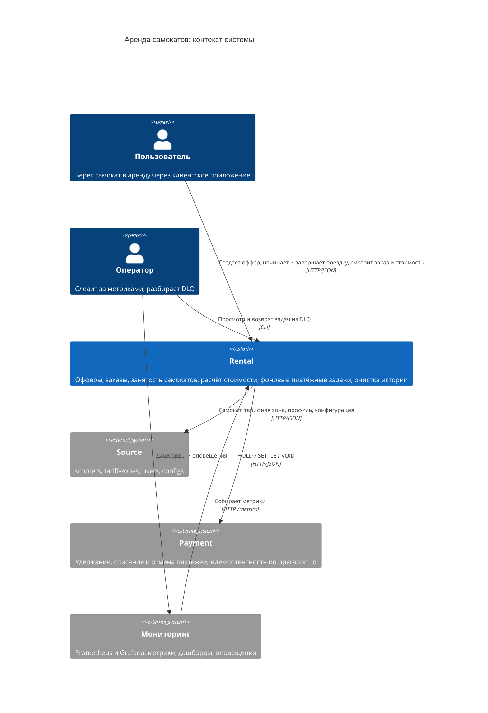
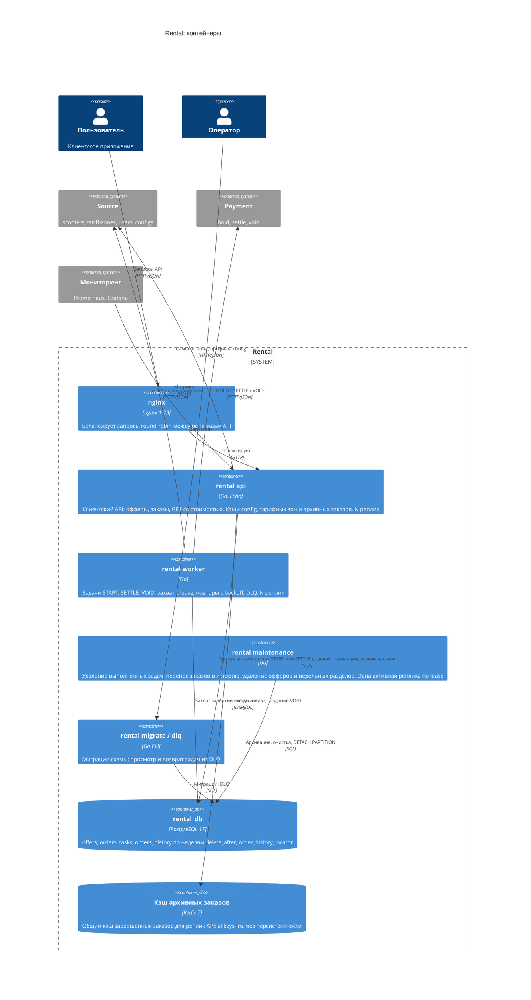
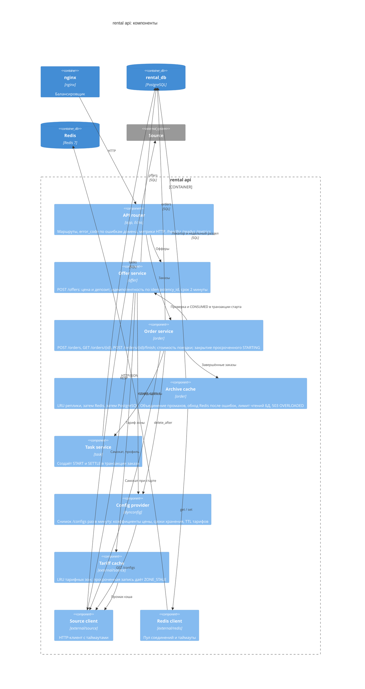
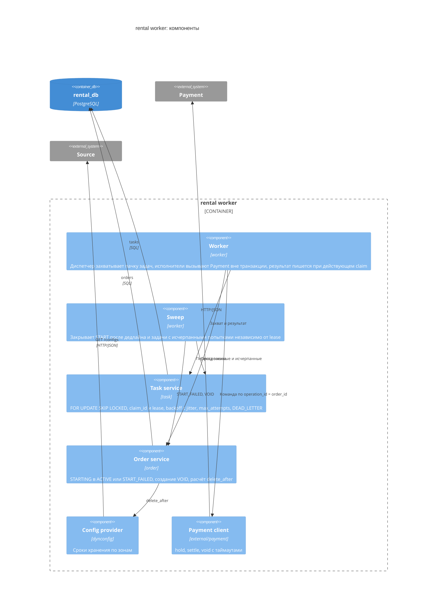
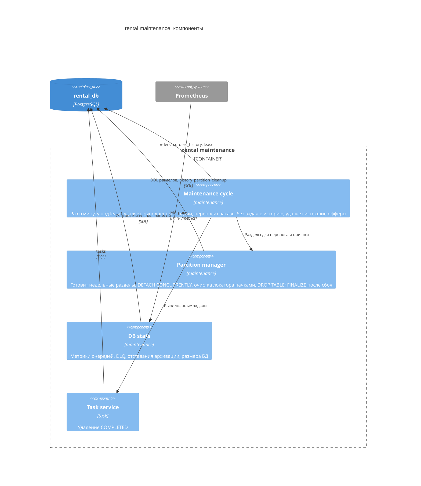
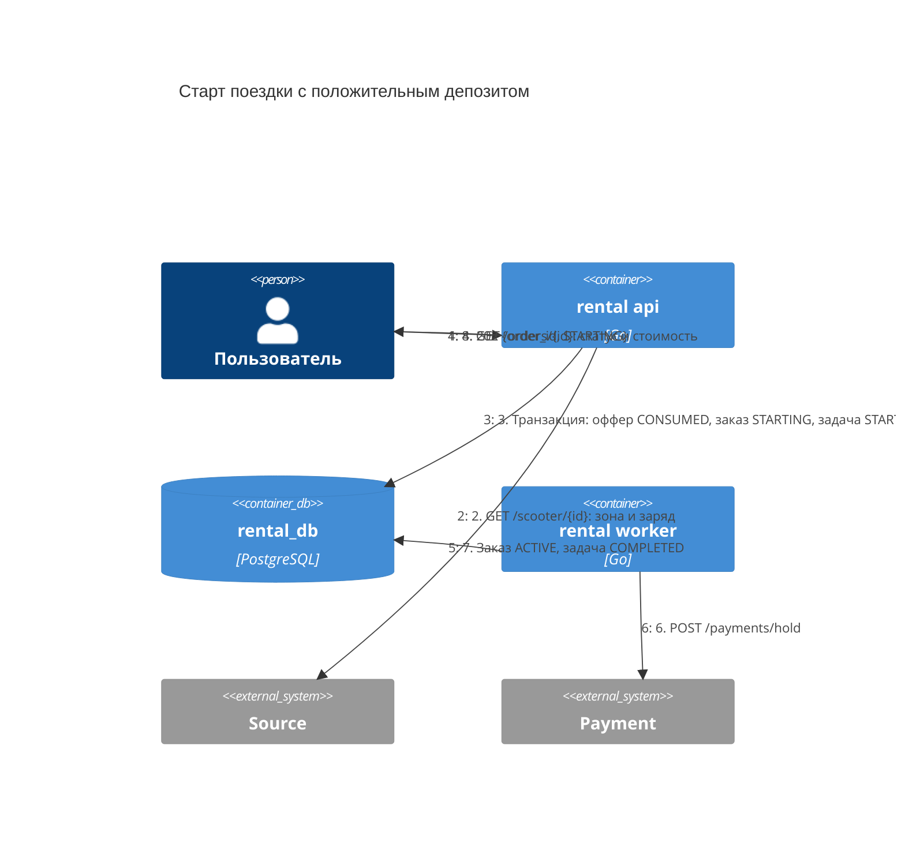
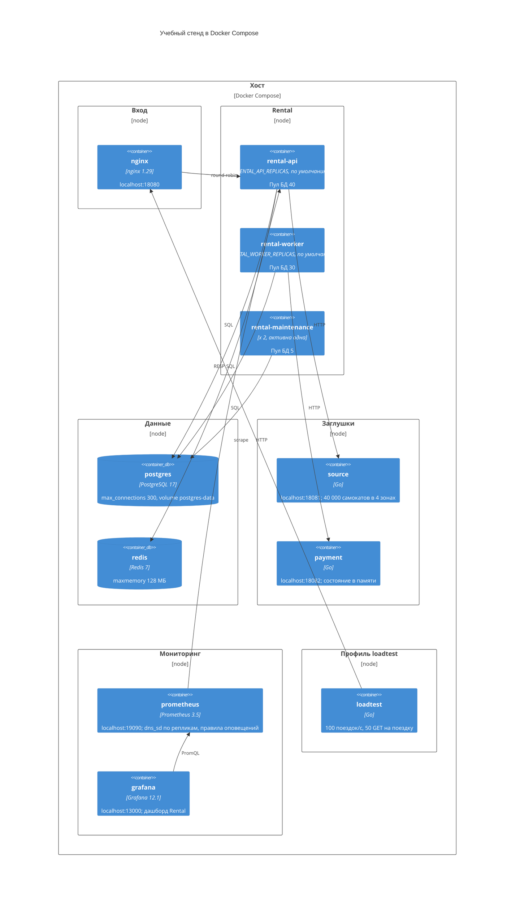

# C4-модель аренды самокатов

Диаграммы описывают архитектуру из [ADR](ADR.md) в нотации [C4](https://c4model.com) и записаны на Mermaid (GitHub отображает их без дополнительных инструментов). Контракты внешних сервисов приведены в [EXTERNAL_SERVICES.md](EXTERNAL_SERVICES.md).

| Уровень | Что показывает |
| --- | --- |
| [1. Контекст](#уровень-1-контекст) | Rental, его пользователи и внешние системы |
| [2. Контейнеры](#уровень-2-контейнеры) | Процессы Rental, хранилища и связи между ними |
| [3. Компоненты](#уровень-3-компоненты) | Пакеты внутри `rental api`, `rental worker` и `rental maintenance` |
| [Динамика: старт поездки](#динамическая-диаграмма-старт-поездки) | Асинхронный старт через задачу START |
| [Развёртывание](#развёртывание-учебный-стенд) | Docker Compose стенд, мониторинг и эмулятор нагрузки |

## Уровень 1. Контекст

Критичность источников (требования команды 4) и поведение Rental при их отказе:

| Источник | Критичность | Поведение при отказе |
| --- | --- | --- |
| Source: scooters | Критичный | Оффер и новый заказ не создаются (`503 SOURCE_UNAVAILABLE`); начатую поездку можно завершить |
| Payment | Критичный | START ограничен дедлайном и числом попыток; SETTLE и VOID повторяются с backoff, затем попадают в DLQ |
| Source: configs | Некритичный | Кэш обновляется раз в минуту; при сбое остаётся последний валидный снимок, при холодном старте — значения по умолчанию |
| Source: tariff-zones | Некритичный | LRU-кэш; запись старше `tariff_zone_cache_ttl_minutes` (по умолчанию 10 минут) недействительна — `503 ZONE_STALE` |
| Source: users | Некритичный | Фоллбэк на жадный прайсинг: полный депозит и полная цена разблокировки |

## Уровень 2. Контейнеры

Все процессы Rental собраны из одного бинарника `services/rental/cmd/rental` и различаются командой запуска. Каждый процесс отдаёт `/healthz`, `/readyz` и `/metrics`.

Prometheus также опрашивает `rental worker`, `rental maintenance`, Source и Payment; на диаграмме оставлена одна связь, чтобы не перегружать схему.

| Контейнер | Масштабирование | Состояние |
| --- | --- | --- |
| `rental api` | Горизонтально, без привязки клиента к реплике | Локальные кэши восстанавливаются; заказы в PostgreSQL |
| `rental worker` | Горизонтально; задачи делятся через `FOR UPDATE SKIP LOCKED` | Lease и `claim_id` в `tasks` |
| `rental maintenance` | Несколько реплик, активна одна | Lease и журнал `history_partition_cleanup` в PostgreSQL |
| PostgreSQL | Вертикально; бюджет в [RESOURCE_BUDGET.md](RESOURCE_BUDGET.md) | Источник истины |
| Redis | Одна инстанция; при сбое API обходит его | Восстанавливаемый кэш |

## Уровень 3. Компоненты

Компоненты соответствуют пакетам `services/rental/internal/`. Пакеты `platform/postgres` (пул, транзакции, время БД), `platform/httpx` и `metrics` используются всеми компонентами и на схемах не показаны.

### rental api

### rental worker

### rental maintenance

## Динамическая диаграмма: старт поездки

Старт асинхронный: API фиксирует заказ и задачу в одной транзакции и сразу отвечает, а HOLD выполняет worker.

При явном `failed` от HOLD заказ становится `START_FAILED`. При истечении дедлайна или исчерпании попыток заказ тоже закрывается как `START_FAILED`, а при положительном депозите создаётся задача VOID. Завершение поездки устроено так же: `POST /orders/{id}/finish` фиксирует стоимость и создаёт SETTLE, которую выполняет worker.

## Развёртывание: учебный стенд

Стенд описан в [`compose.yaml`](../compose.yaml); эмулятор нагрузки добавляется через [`compose.loadtest.yaml`](../compose.loadtest.yaml).

Перед стартом процессов Rental одноразовый контейнер `migrate` применяет миграции; `rental-*` стартуют после его успешного завершения и готовности Source и Payment.

Продовый бюджет (4 экземпляра Rental по 3 vCPU и 2 ГиБ, PostgreSQL на 16 vCPU, 64 ГиБ RAM и 9 ТБ диска) рассчитан в [RESOURCE_BUDGET.md](RESOURCE_BUDGET.md).
