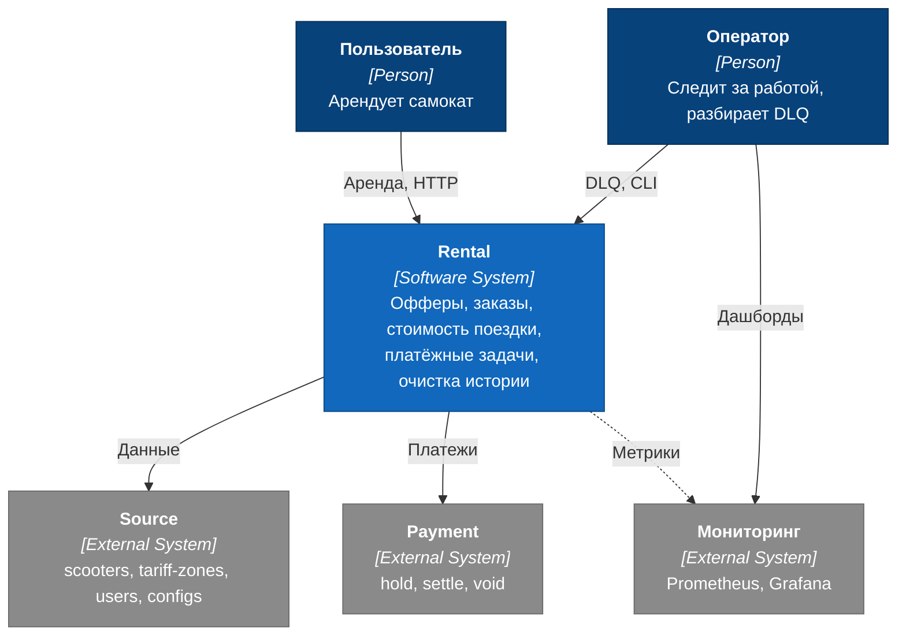
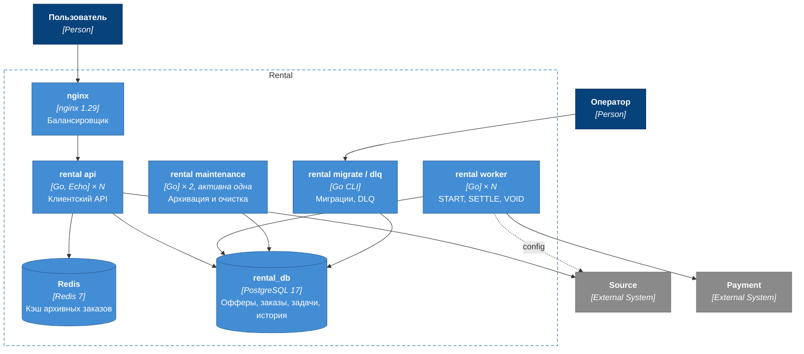
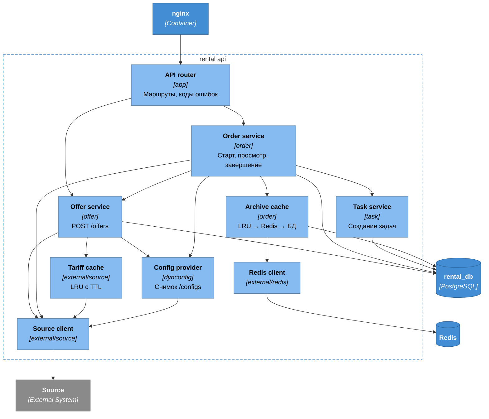
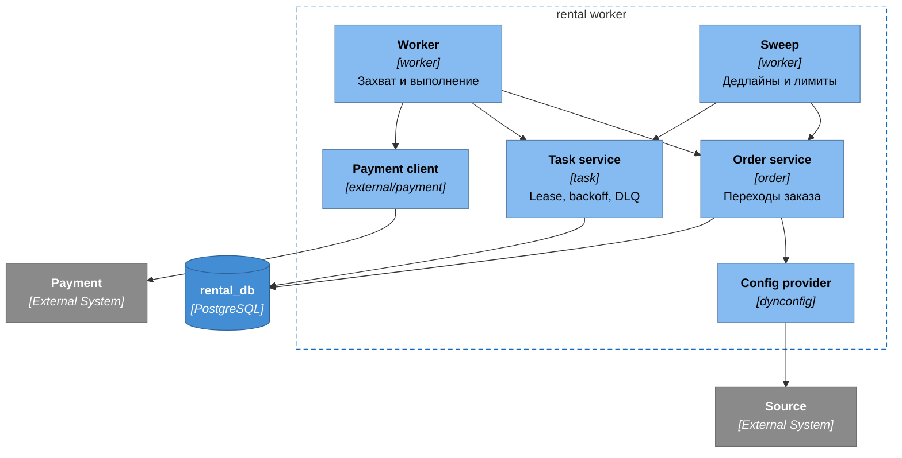
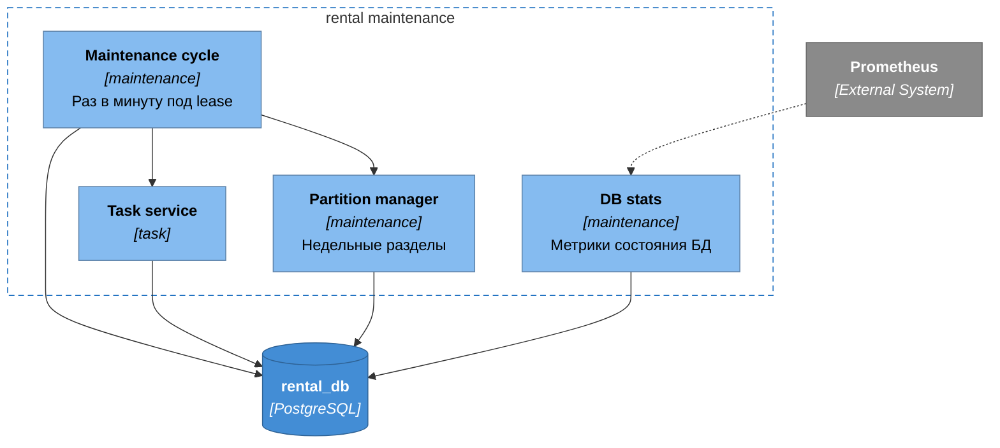
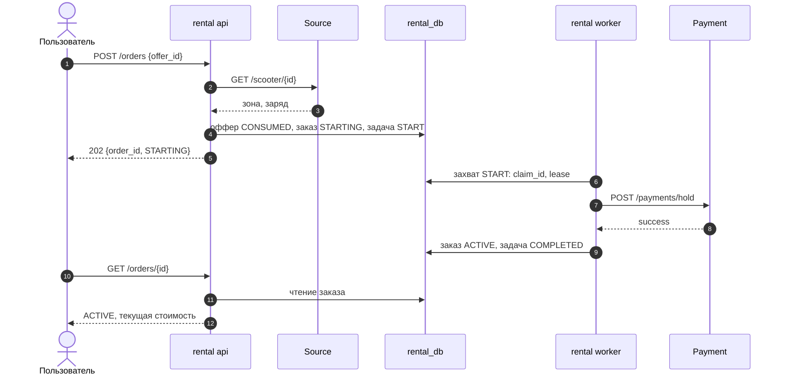
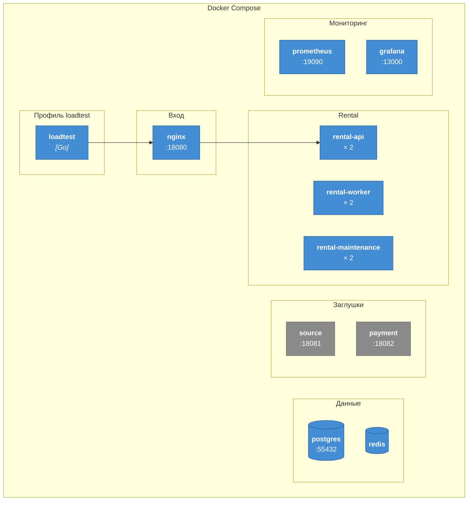

# C4-модель аренды самокатов

Диаграммы описывают архитектуру из [ADR](ADR.md) по уровням [C4](https://c4model.com). Они записаны на Mermaid и отображаются на GitHub. Контракты внешних сервисов приведены в [EXTERNAL_SERVICES.md](EXTERNAL_SERVICES.md).

Обозначения: тёмно-синий — человек, синий — система или контейнер Rental, голубой — компонент, серый — внешняя система, цилиндр — хранилище, пунктирная рамка — граница системы или контейнера. Подписи стрелок короткие; подробности связей вынесены в таблицы под диаграммами.

| Уровень | Что показывает |
| --- | --- |
| [1. Контекст](#уровень-1-контекст) | Rental, его пользователи и внешние системы |
| [2. Контейнеры](#уровень-2-контейнеры) | Процессы Rental и хранилища |
| [3. Компоненты](#уровень-3-компоненты) | Пакеты внутри `rental api`, `rental worker` и `rental maintenance` |
| [Динамика](#динамика-старт-поездки) | Асинхронный старт поездки |
| [Развёртывание](#развёртывание-учебный-стенд) | Docker Compose стенд |

## Уровень 1. Контекст

| Связь | Содержание |
| --- | --- |
| Пользователь → Rental | Создать оффер, начать и завершить поездку, посмотреть заказ и текущую стоимость |
| Оператор → Rental | `rental dlq list`, `rental dlq requeue` |
| Rental → Source | Самокат (зона, заряд), тарифная зона, профиль пользователя, конфигурация |
| Rental → Payment | HOLD депозита, SETTLE стоимости, VOID после неудачного старта; `operation_id` = `order_id` |
| Мониторинг → Rental | Prometheus опрашивает `/metrics` всех процессов |

Критичность источников (требования команды 4) и поведение Rental при их отказе:

| Источник | Критичность | Поведение при отказе |
| --- | --- | --- |
| Source: scooters | Критичный | Оффер и новый заказ не создаются (`503 SOURCE_UNAVAILABLE`); начатую поездку можно завершить |
| Payment | Критичный | START ограничен дедлайном и числом попыток; SETTLE и VOID повторяются с backoff, затем попадают в DLQ |
| Source: configs | Некритичный | Кэш обновляется раз в минуту; при сбое остаётся последний валидный снимок, при холодном старте — значения по умолчанию |
| Source: tariff-zones | Некритичный | LRU-кэш; запись старше `tariff_zone_cache_ttl_minutes` (по умолчанию 10 минут) недействительна — `503 ZONE_STALE` |
| Source: users | Некритичный | Фоллбэк на жадный прайсинг: полный депозит и полная цена разблокировки |

## Уровень 2. Контейнеры

Все процессы Rental собраны из одного бинарника `services/rental/cmd/rental` и различаются командой запуска. Каждый процесс отдаёт `/healthz`, `/readyz` и `/metrics`; связи с мониторингом на схеме не показаны.

| Связь | Протокол | Содержание |
| --- | --- | --- |
| nginx → rental api | HTTP | Round-robin по репликам; адреса перечитываются через DNS Docker |
| rental api → rental_db | SQL | Оффер; заказ и задача START или SETTLE в одной транзакции; чтение заказов и истории |
| rental api → Redis | RESP | Завершённые архивные заказы, общие для реплик |
| rental api → Source | HTTP/JSON | Самокат, тарифная зона, профиль, `/configs` |
| rental worker → rental_db | SQL | Захват задач, переходы заказа, создание VOID |
| rental worker → Payment | HTTP/JSON | HOLD, SETTLE, VOID |
| rental worker → Source | HTTP/JSON | `/configs`: сроки хранения для `delete_after` при `START_FAILED` |
| rental maintenance → rental_db | SQL | Удаление задач, перенос в `orders_history`, `DETACH PARTITION` |
| rental migrate / dlq → rental_db | SQL | Миграции схемы, просмотр и возврат задач из DLQ |

| Контейнер | Масштабирование | Состояние |
| --- | --- | --- |
| `rental api` | Горизонтально, без привязки клиента к реплике | Локальные кэши восстанавливаются; заказы в PostgreSQL |
| `rental worker` | Горизонтально; задачи делятся через `FOR UPDATE SKIP LOCKED` | Lease и `claim_id` в `tasks` |
| `rental maintenance` | Несколько реплик, активна одна | Lease и журнал `history_partition_cleanup` в PostgreSQL |
| PostgreSQL | Вертикально; бюджет в [RESOURCE_BUDGET.md](RESOURCE_BUDGET.md) | Источник истины |
| Redis | Одна инстанция; при сбое API обходит его | Восстанавливаемый кэш |

## Уровень 3. Компоненты

Компоненты соответствуют пакетам `services/rental/internal/`. Общие пакеты `platform/postgres` (пул, транзакции, время БД), `platform/httpx` и `metrics` на схемах не показаны.

### rental api

| Компонент | Ответственность |
| --- | --- |
| API router | Маршруты Echo, преобразование ошибок домена в `error_code`, метрики HTTP, `/healthz`, `/readyz`, `/metrics` |
| Offer service | Цена и депозит по данным Source, идемпотентность по `idempotency_id`, срок оффера 2 минуты |
| Order service | `POST /orders`, `GET /orders/{id}`, `POST /orders/{id}/finish`; переводит оффер в `CONSUMED` в транзакции старта; закрывает просроченный `STARTING`; считает стоимость и `delete_after` |
| Task service | Создаёт START и SETTLE в одной транзакции с заказом |
| Archive cache | LRU реплики, затем Redis, затем локатор и один недельный раздел `orders_history`. Объединяет одновременные промахи, обходит Redis после трёх ошибок, ограничивает параллельные чтения БД, отвечает `503 OVERLOADED` |
| Config provider | Обновляет `/configs` раз в минуту; хранит последний валидный снимок или значения по умолчанию |
| Tariff cache | LRU тарифных зон; запись старше TTL из config даёт `ZONE_STALE` |
| Source client, Redis client | HTTP- и Redis-клиенты с таймаутами |

### rental worker

| Компонент | Ответственность |
| --- | --- |
| Worker | Захватывает пачку задач короткой транзакцией, вызывает Payment вне транзакции, записывает результат только при действующем `claim_id` |
| Sweep | Закрывает START после дедлайна и задачи с исчерпанными попытками независимо от lease |
| Task service | `FOR UPDATE SKIP LOCKED`, `claim_id` и lease, backoff с jitter, `max_attempts`, перевод в `DEAD_LETTER` |
| Order service | `STARTING` → `ACTIVE` или `START_FAILED`, создание VOID, расчёт `delete_after` |
| Payment client | HOLD, SETTLE, VOID с таймаутами; `operation_id` = `order_id` |
| Config provider | Сроки хранения по зонам |

### rental maintenance

| Компонент | Ответственность |
| --- | --- |
| Maintenance cycle | Под lease в PostgreSQL удаляет выполненные задачи, переносит заказы без задач в `orders_history`, удаляет истекшие офферы |
| Partition manager | Готовит недельные разделы по `delete_after`; удаляет истекшие через `DETACH PARTITION CONCURRENTLY` и `DROP TABLE`, чистит локатор пачками, после сбоя завершает DETACH через `FINALIZE` |
| Task service | Удаление задач `COMPLETED` |
| DB stats | Метрики очередей, DLQ, отставания архивации и размера БД |

## Динамика: старт поездки

Старт асинхронный: API фиксирует заказ и задачу в одной транзакции и сразу отвечает, а HOLD выполняет worker.

При явном `failed` от HOLD заказ становится `START_FAILED`. При истечении дедлайна или исчерпании попыток заказ тоже закрывается как `START_FAILED`, а при положительном депозите создаётся задача VOID. Завершение поездки устроено так же: `POST /orders/{id}/finish` фиксирует стоимость и создаёт SETTLE, которую выполняет worker.

## Развёртывание: учебный стенд

Стенд описан в [`compose.yaml`](../compose.yaml); эмулятор нагрузки добавляется через [`compose.loadtest.yaml`](../compose.loadtest.yaml). Связи между контейнерами те же, что на [диаграмме контейнеров](#уровень-2-контейнеры); здесь показан только путь клиентского запроса.

| Узел | Контейнер | Параметры |
| --- | --- | --- |
| Вход | nginx 1.29 | `localhost:18080`, round-robin, keepalive к репликам |
| Rental | `rental-api` | `RENTAL_API_REPLICAS`, по умолчанию 2; пул БД 40 |
| Rental | `rental-worker` | `RENTAL_WORKER_REPLICAS`, по умолчанию 2; пул БД 30 |
| Rental | `rental-maintenance` | 2 реплики, активна одна; пул БД 5 |
| Rental | `migrate` | Одноразовый; `rental-*` стартуют после его успешного завершения и готовности Source и Payment |
| Данные | PostgreSQL 17 | `localhost:55432`, `max_connections=300`, volume `postgres-data` |
| Данные | Redis 7 | `maxmemory 128mb`, `allkeys-lru`, без персистентности |
| Заглушки | source, payment | `localhost:18081` (40 000 самокатов в 4 зонах), `localhost:18082` (состояние в памяти) |
| Мониторинг | Prometheus 3.5, Grafana 12.1 | `localhost:19090` (dns_sd по репликам, правила оповещений), `localhost:13000` (дашборд Rental) |
| Профиль loadtest | loadtest | 100 поездок/с, 50 GET на поездку, через nginx |

Продовый бюджет (4 экземпляра Rental по 3 vCPU и 2 ГиБ, PostgreSQL на 16 vCPU, 64 ГиБ RAM и 9 ТБ диска) рассчитан в [RESOURCE_BUDGET.md](RESOURCE_BUDGET.md).
