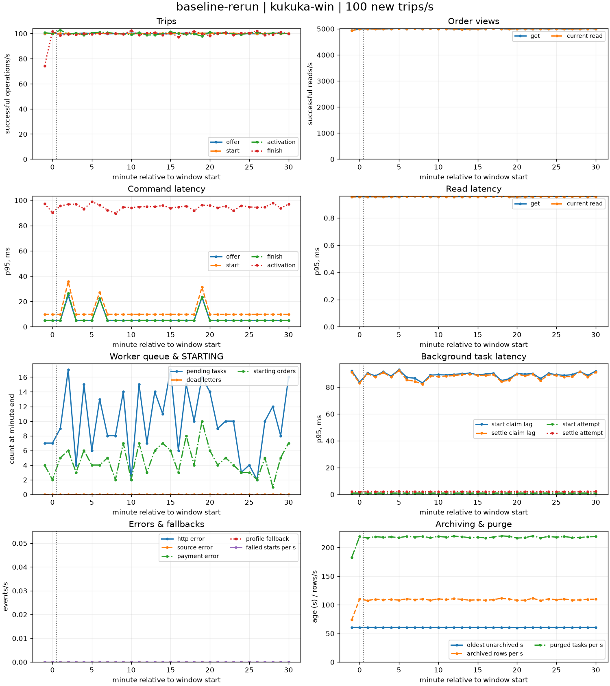
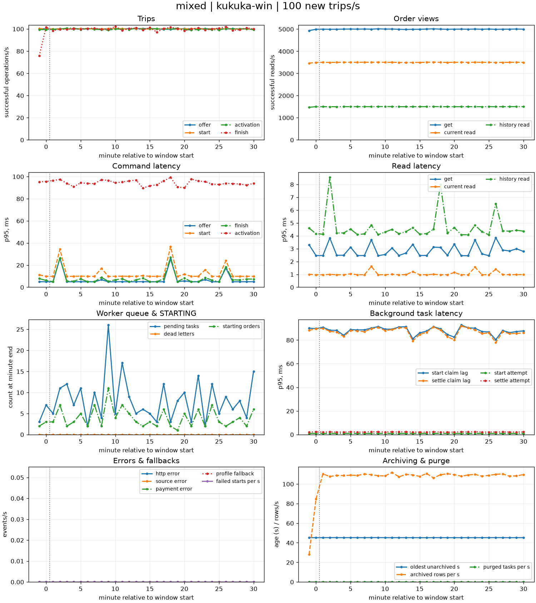
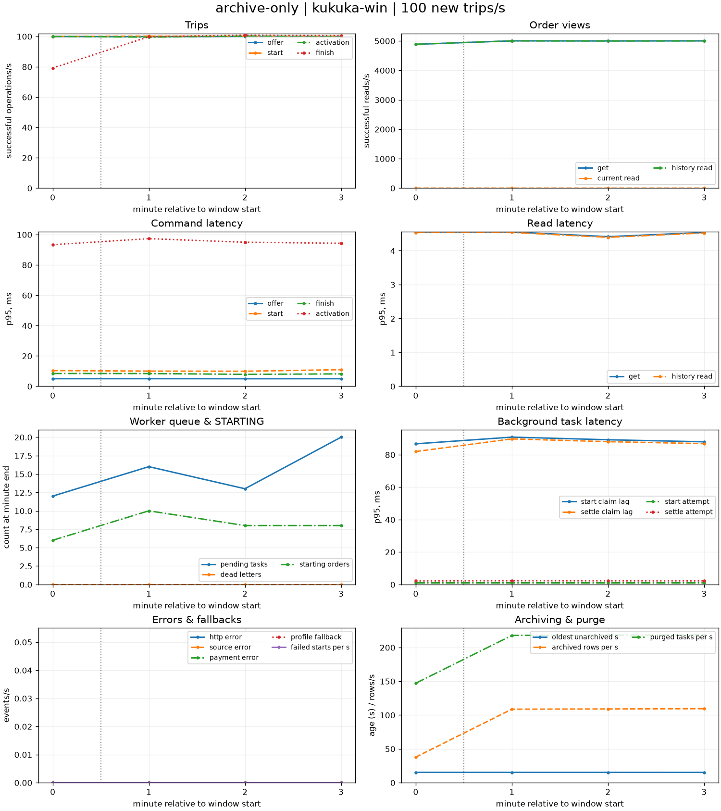
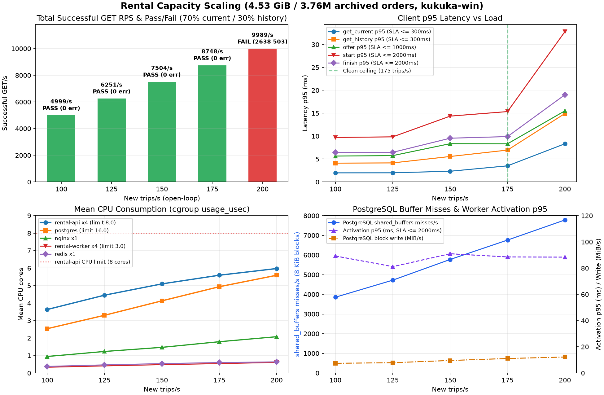
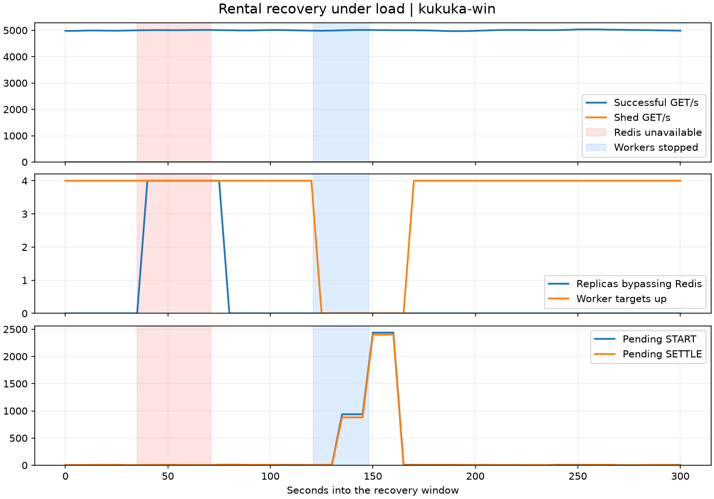
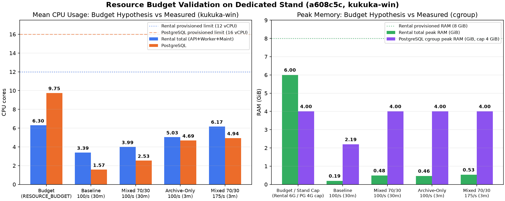

# Отчёт о нагрузочном и функциональном тестировании Rental

**Ревизия:** `a608c5c765c0d37f633671162d54c8cb7102e5e5` (ветка `codex/loadtest`) · **Дата:** 24 ноября 2026  
**Стенд:** `kukuka-win` (Ryzen 9 5950X, Ubuntu WSL2, Docker 29.1.3 / Compose 2.40.3, жёсткие лимиты cgroup v2)  
**Документы:** [TEST_PLAN.md](TEST_PLAN.md) · [RESOURCE_BUDGET.md](RESOURCE_BUDGET.md) · [EMULATOR_SCENARIOS.md](EMULATOR_SCENARIOS.md) · [ADR.md](ADR.md)

---

## Итоги приёмки

Все целевые сценарии [TEST_PLAN.md](TEST_PLAN.md) на нагрузке **100 новых поездок/с и 5 000 просмотров/с (30-минутные окна после 7-минутного разогрева)** пройдены (**PASS**): 0 ошибок HTTP, 0 двойных аренд и списаний, 100% валидация формул цены и тарифов, `1 000 / 1 000 PAID` в `Payment` и полное дренирование очередей и архивации.

| Сценарий | Профиль и объём | Успешные RPS | p95 `get_current` / `get_history` (SLA ≤ 300 мс) | p95 `offer` / `start` / `finish` / `activation` | Ошибки HTTP | Итог |
| --- | --- | --- | ---: | ---: | ---: | --- |
| **Базовый** | 100/с, 50 GET/поездку, 7м + **30м**, пустая БД | 100,00 / **4 999,37** GET/с | **1,83 мс** / — | 5,02 / 8,01 / 5,66 / **90,63 мс** | **0** | **PASS** |
| **Смешанный** | 100/с, 35 тек. + 15 арх. GET, **4,53 GiB** (3,76M строк, 53+1 парт.), 7м + **30м** | 100,00 / **3 499,64 + 1 499,72** | **1,98 мс** / **4,10 мс** | 5,65 / 9,70 / 6,43 / **89,27 мс** | **0** | **PASS** |
| **100% архив** | 100/с, 50 арх. GET/поездку, **4,53 GiB**, 2м + 3м | 100,00 / **4 999,62** арх. | — / **4,18 мс** | 5,78 / 10,43 / 6,54 / **91,08 мс** | **0** | **PASS** |
| **Потолок 125–175/с** | 125 / 150 / **175/с**, 70/30 GET, 4,53 GiB, 2м + 3м | до **8 747,81** GET/с | **3,51 мс** / **6,95 мс** (175/с) | 8,32 / 15,36 / 9,90 / 88,53 мс | **0** | **PASS (запас 1,75×)** |
| **Потолок 200/с** | 200/с, 70/30 GET, 4,53 GiB, 2м + 3м | **9 988,67** GET/с | 8,33 мс / 14,93 мс | 15,51 / 32,80 / 19,02 / 88,40 мс | 2 638 (`503`, 0,088%) | **FAIL** (shedding) |
| **Отказы (`recovery`)** | 100/с, 70/30 GET, 2м + 5м; стоп Redis (36 с) и всех 4 worker (27 с) | 100,00 / **5 001,57** GET/с | **1,87 мс** / **3,79 мс** | 5,29 / 8,85 / 5,98 / 13 971 мс\* | **0** | **OK по отказам**\* |
| **Автотесты** | 8 функц. + 10 unit/integ. пакетов Rental (`-race`), Go/Python эмулятора, `promtool` | — | — | — | 0 | **PASS** |

*\*В `recovery` все 42 000 поездок и 1 000/1 000 платежей завершились без ошибок; `activation p95 = 13,97 с` ожидаемо превысил штатный SLA 2 с из-за намеренной 27-секундной остановки всех воркеров.*

Главные выводы:
- **SLA выдержан с кратным запасом:** `p95` чтений `1,83–4,18 мс` (при лимите `300 мс`), активации `89–91 мс` (при лимите `2 000 мс`).
- **Чистый запас мощности — 1,75×:** без единой ошибки стенд держит **175 поездок/с и 8 750 GET/с** при 4,53 GiB истории.
- **Фактический расход ресурсов ниже бюджета [RESOURCE_BUDGET.md](RESOURCE_BUDGET.md):** Rental потребляет **3,39–3,99 CPU** и **0,19–0,48 GiB RAM** (против гипотез 6,30 CPU / 6 GiB), PostgreSQL — **1,57–2,53 CPU** (против 9,75 CPU).

---

## 1. Нагрузочный эмулятор (`tools/loadtest`)

Эмулятор выделен в отдельный Go-модуль [tools/loadtest](../tools/loadtest) со скриптами подготовки и аудита [tools/loadtest/scripts](../tools/loadtest/scripts) и подключается через [compose.loadtest.yaml](../compose.loadtest.yaml) без изменений в коде Rental.

- **Честный open-loop без coordinated omission ([main.go](../tools/loadtest/main.go)):** поездки стартуют строго по расписанию `due = start + n / rate` с воспроизводимой длительностью (`-seed`), а задержка считается как `end - due`.
- **Бесконфликтный пул парка ([fleet.go](../tools/loadtest/fleet.go)):** FIFO для `40 000` самокатов + случайная выборка из `40 000` пользователей гарантируют ≤ 1 активной поездки на самокат и пользователя и разрывают корреляцию между `scooter-N` и `user-M`, обеспечивая покрытие всех **16 из 16** ценовых комбинаций `(zone, subscription, trusted)`.
- **Развязанная очередь чтений ([read_queue.go](../tools/loadtest/read_queue.go)):** ограниченный FIFO (`32 768`) и пул HTTP-воркеров (`1 536–4 096`) отслеживают `peak_queued`, `max_dispatch_delay_ms` и `overflows`. Переполнение очереди сразу помечает прогон как `FAIL` (`generator_saturated`), исключая тихое занижение нагрузки. Во всех приёмочных прогонах `overflows = 0` (пик ≤ `50 / 32 768`).
- **Онлайн-валидация и аудит ([validation.go](../tools/loadtest/validation.go), [recovery.go](../tools/loadtest/recovery.go)):** каждый ответ проверяется на лету — квота оффера, отсутствие цены в `STARTING`, точный биллинг в `ACTIVE` (бинарный поиск по интервалу `[sent - skew, received + skew]` с учётом 5-секундного порога), финальная стоимость `COMPLETED`/`CANCELLED`/`START_FAILED`. Для сценариев без текущих GET (`archive-only`) биллинг допроверяется через `finishAudits()`, а неоднозначные ответы закрываются пост-дрейновым `reconcile()` без скрытия ошибок окна.
- **Контур верификации ([tools/loadtest/scripts](../tools/loadtest/scripts)):**
  - `prepare-emulator-data.py` + `seed-history.sql` — потоковая генерация миллионных фикстур в `O(1)` памяти, сверка SHA-256 UUID, контроль размера строки (~1 КБ) и превышения `shared_buffers`.
  - `run-profile.py` + [check-profile.sql](../tools/loadtest/scripts/check-profile.sql) — замер стабильности бэклога, дренаж `worker`/`maintenance` и полная SQL-сверка по `orders ∪ orders_history` (тарифы, биллинг, `delete_after`, двойные аренды, переиспользование офферов, `activation_p95_ms`).
  - `check-profile-payments.py` и `export-window.py` — выборочная сверка `1 000` платежей в `Payment` и экспорт поминутных метрик Prometheus (включая pre-window стабилизацию ±5%) с рендерингом графиков 4×2.

---

## 2. Стенд и ограничения ресурсов

На `kukuka-win` сервисы Rental и PostgreSQL работали под жёсткими лимитами Linux cgroup v2 (`compose.loadtest.acceptance.yaml`):

| Сервис | Реплики | Лимит cgroup (CPU / RAM) | Ключевые настройки |
| --- | ---: | ---: | --- |
| `rental-api` | 4 | 2,0 CPU / 1 280 MiB × 4 = **8,0 CPU / 5,0 GiB** | `RENTAL_DB_MAX_CONNS=40`, L1 LRU `65 536` (`1m`), `ORDER_READ_DB_MAX_CONCURRENCY=24` (`12` degraded, wait `250ms`) |
| `rental-worker` | 4 | 0,75 CPU / 512 MiB × 4 = **3,0 CPU / 2,0 GiB** | `RENTAL_DB_MAX_CONNS=30`, `WORKER_CONCURRENCY=64`, `PAYMENT_TIMEOUT=3s` |
| `rental-maintenance` | 2 | 0,5 CPU / 512 MiB × 2 = **1,0 CPU / 1,0 GiB** | `RENTAL_DB_MAX_CONNS=5`, `MAINTENANCE_INTERVAL=1m`, `MAINTENANCE_BATCH_SIZE=2000` |
| **`Rental` итого** | **10** | **12,0 CPU / 8,0 GiB** | Совпадает с бюджетом [RESOURCE_BUDGET.md](RESOURCE_BUDGET.md) |
| `postgres` | 1 | **16,0 CPU / 4,0 GiB** | `postgres:17-alpine`, `max_connections=300`, `shared_buffers=512MB`, ext4 `/dev/sde` |
| `redis` | 1 | без cgroup-лимита (`--maxmemory 128mb`) | `redis:7-alpine`, `allkeys-lru`, без персистентности |
| `nginx`, `source`, `payment`, `prometheus`, `loadtest` | по 1 | без cgroup-лимита | `40 000` самокатов (4 зоны) и `40 000` пользователей; `scrape_interval=5s` |

Лимит RAM `postgres` в **4 GiB** при объёме истории **4,53 GiB** задан специально, чтобы архив не помещался в кэш контейнера и генерировал реальные чтения с блочного устройства.

---

## 3. Функциональные и интеграционные проверки

На стенде пройдены все автоматические проверки из [TEST_PLAN.md](TEST_PLAN.md):
- **10 пакетов unit/integration Rental (`-race`):** включая `EXPLAIN ANALYZE` локатора (один `Index Scan` по выбранной партиции), миграцию старой схемы и продолжение очистки по курсору.
- **8 функциональных пакетов (`-tags=functional -race`):** конкурентный старт, нулевой депозит и просроченный старт, `HOLD`/`VOID` и потерянные ответы, захват задач и гонки с API, завершение и `SETTLE`/DLQ, ошибки `4xx` от Payment, отказы Source и кэши, архивация и очистка под нагрузкой.
- **Эмулятор и алертинг:** Go-тесты `tools/loadtest` (`-race`), 11 Python-тестов `test_scripts.py`, `promtool test rules` для `RentalTaskDeadLettered`.
- **Отдельный тест отказа Redis с эксклюзивной блокировкой `orders`:** прогретый архивный GET → `200` из L1 LRU; из 80 одновременных промахов 24 заняли слоты PG и получили `404` после снятия блокировки, 56 отсечены `503 OVERLOADED`; после запуска Redis общий кэш восстановился.

---

## 4. Базовый прогон (100 поездок/с, 5 000 GET/с, 30 мин) — PASS

- **Условия:** пустая БД, `40 000` самокатов/пользователей, поездки `4–6 мин`, 7 мин разминки + 30 мин окно (`20:20:01–20:50:01 МСК`) + дренаж ~6 мин. В последнюю минуту разминки все 4 темпа в пределах ±5% (`100,16 / 100,06 / 101,86 / 4 993,24`).
- **Результаты:**
  - Поездки: **222 000 / 222 000** (180 000 в окне); первичные GET: **11 100 000 / 11 100 000** валидированы.
  - RPS / p95: `offer 100,00 / 5,02 мс`, `start 100,00 / 8,01 мс`, `finish 99,95 / 5,66 мс`, `get_current 4 999,37 / 1,83 мс`, `activation 100,00 / 90,63 мс`.
  - Ошибки и инварианты: **0** ошибок HTTP, **0** `START_FAILED`, **0** `wrong_terms/bills/retention/overlaps`, **16/16** ценовых комбинаций, `mean_order_row_bytes = 1 028 Б`, `max_archive_lag_s = 59,77 с` (`backlog_stable = true`), после дрейна `unarchived = 0`, `DLQ = 0`, **1 000 / 1 000 `PAID`**.
  - БД и ресурсы: итоговый размер БД `398 МиБ` (54 раздела), PostgreSQL **1,57 CPU** / пик **2,19 GiB RAM** / запись **8,51 GiB** / чтение **0 GiB** (`99,999997%` buffer hit), Rental **3,39 CPU** / пик **0,19 GiB RAM**.

---

## 5. Смешанный прогон с историей 4,53 GiB (30 мин) — PASS

- **Фикстура:** **3 756 094** актуальных заказа в 53 недельных разделах (`3 721 052 COMPLETED`, `77 521 CANCELLED`, `77 521 START_FAILED`) + **120 000** просроченных в 1 разделе; `mean_row_bytes = 1 044 Б`; суммарный объём **4,53 GiB** (`4,23 GiB` таблиц + `306,6 MiB` индексов — в **9×** выше `shared_buffers = 512 MiB`). `rental-maintenance` стартовал под живой нагрузкой (`--start-maintenance`).
- **Условия:** 7 мин разминки + 30 мин окно (`18:33:17–19:03:17 МСК`, pre-window в ±5%: `100,16 / 100,00 / 101,55 / 4 992,07`), цель `3 500 get_current/с` + `1 500 get_history/с`.
- **Результаты:**
  - Поездки: **222 000 / 222 000**; GET: **7 770 000** текущих + **3 330 000** архивных валидированы (100%).
  - RPS / p95: `offer 100,00 / 5,65 мс`, `start 100,00 / 9,70 мс`, `finish 99,95 / 6,43 мс`, `get_current 3 499,64 / 1,98 мс`, `get_history 1 499,72 / 4,10 мс`, `activation 100,00 / 89,27 мс`.
  - Очистка под нагрузкой: просроченный раздел (`120 000` строк) физически удалён в **18:33:22 МСК** без ошибок и скачка задержек; все **3 756 094** актуальных заказа сохранены.
  - Инварианты и дренаж: **0** ошибок, **0** нарушений SQL, **1 000 / 1 000 `PAID`**, `max_archive_lag_s = 59,88 с`, `unarchived = 0`, `DLQ = 0`.
  - Ресурсы и I/O: PostgreSQL **2,53 CPU** / пик **4,00 GiB RAM** / **19,55 GiB** чтений с диска (`6,79 млн` промахов `shared_buffers`, `93,13%` hit) и **13,02 GiB** записи; Rental **3,99 CPU** / пик **0,48 GiB RAM**.

---

## 6. 100% архивные чтения (`archive-only`) и потолок мощности (`capacity-125..200`)

### 6.1. 100% архивные чтения (`archive-only`, 3 мин) — PASS
На том же датасете `4,53 GiB` все 50 GET на поездку направлены в архив (**5 000 архивных GET/с** + 100 новых поездок/с, поездки `60–90 с`):
- **4 999,62 архивных GET/с**, клиентский **`p95 = 4,18 мс`**, `activation p95 = 91,08 мс`, **0 ошибок**, **30 000 / 30 000** поездок, **1 500 000 / 1 500 000** архивных GET, **1 000 / 1 000 `PAID`**.
- **Ресурсы:** PostgreSQL **4,69 CPU**, **7,42 GiB** чтений с диска за 3 мин (~42,2 МиБ/с, `86,21%` buffer hit); Rental **5,03 CPU** / **0,46 GiB RAM**; Redis **0,55 CPU** / `129 MiB`.

### 6.2. Ступенчатый поиск потолка (100 → 200 поездок/с, 70/30 GET, 4,53 GiB)

| Нагрузка | Успешных GET/с | `get_current` / `get_history` p95 | `offer` / `start` / `finish` p95 | Ошибки HTTP | PG CPU / API CPU / nginx CPU | PG buffer misses/с | Итог |
| --- | ---: | ---: | ---: | ---: | ---: | ---: | --- |
| **100/с** (`mixed`, 30м) | 4 999,36 | 1,98 / 4,10 мс | 5,65 / 9,70 / 6,43 мс | **0** | 2,53 / 3,63 / 0,94 | 3 854/с | **PASS** |
| **125/с** (`capacity-125`) | 6 251,10 | 1,99 / 4,15 мс | 5,74 / 9,84 / 6,46 мс | **0** | 3,30 / 4,45 / 1,23 | 4 717/с | **PASS** |
| **150/с** (`capacity-150`) | 7 503,64 | 2,33 / 5,55 мс | 8,35 / 14,36 / 9,54 мс | **0** | 4,13 / 5,10 / 1,47 | 5 771/с | **PASS** |
| **175/с** (`capacity-175`) | **8 747,81** | **3,51 / 6,95 мс** | 8,32 / 15,36 / 9,90 мс | **0** | **4,94 / 5,59 / 1,79** | **6 753/с** | **PASS (1,75×)** |
| **200/с** (`capacity-200`) | 9 988,67 | 8,33 / 14,93 мс | 15,51 / 32,80 / 19,02 мс | 2 638 (`503`, 0,088%) | 5,59 / 5,98 / 2,08 | 7 791/с | **FAIL** |

- **Чистый потолок конфигурации (`4 API × 2 CPU`):** **175 поездок/с и 8 750 GET/с** с нулём ошибок.
- **На 200 поездок/с (10 000 GET/с):** `rental-api` доходит до ~75% лимита CPU (`5,98 / 8,0`), и при кратких пиках `WALWrite` включается штатный load-shedding `OrderCache` (`1 833` текущих + `805` архивных `503 OVERLOADED`, т.е. `0,088%` чтений). Все **60 000 / 60 000** поездок и **1 000 / 1 000** платежей завершаются без потерь, а `p95` остаётся кратно ниже SLA.

---

## 7. Отказоустойчивость под нагрузкой (`recovery`)

На фоне **100 поездок/с и 5 000 GET/с** (5-минутное окно, 4,53 GiB истории) выполнены две реальные остановки контейнеров:
1. **Стоп `redis` на 36 с:** все **4/4** реплик `rental-api` открыли circuit-breaker и перешли на L1 LRU + ограниченный доступ к PostgreSQL (`12` слотов/реплику). Темп GET удержался на `~5 005/с` с **`0` отсечённых запросов**; через **9 с** после старта `redis` все 4 реплики автоматически вернулись в общий кэш.
2. **Стоп всех 4 `rental-worker` на 27 с:** клиентский API продолжал работу с 0 ошибок; накопилось `2 438 PENDING START` и `2 400 PENDING SETTLE`. После запуска воркеров очередь разгреблась за **~17 с** (`8 START`, `5 SETTLE`), без DLQ и потерь. Все **42 000 / 42 000** поездок и **1 000 / 1 000 `PAID`** подтверждены.

---

## 8. Валидация ресурсного бюджета и выводы для продакшена

| Ресурс | Гипотеза ([RESOURCE_BUDGET.md](RESOURCE_BUDGET.md)) | Лимит бюджета | Базовый (100/с) | Смешанный (100/с, 4,53 GiB) | 100% архив (100/с) | Потолок 175/с |
| --- | ---: | ---: | ---: | ---: | ---: | ---: |
| **Rental, среднее CPU** | 6,30 | 12 vCPU | **3,39** | **3,99** | **5,03** | **6,17** |
| **PostgreSQL, среднее CPU** | 9,75 | 16 vCPU | **1,57** | **2,53** | **4,69** | **4,94** |
| **Rental, пик RAM** | 6,00 GiB | 8 GiB | **0,19 GiB** | **0,48 GiB** | **0,46 GiB** | **0,53 GiB** |
| **PostgreSQL, пик RAM (cgroup)** | 55 GiB (прод) | 64 GiB (стенд 4 GiB) | **2,19 GiB** | **4,00 GiB** | **4,00 GiB** | **4,00 GiB** |
| **PG чтение / запись диска** | — | — | 0 / 8,51 GiB | 19,55 / 13,02 GiB | 7,42 / 1,56 GiB (3м) | 4,44 / 1,94 GiB (3м) |
| **Строка истории (heap + инд.)** | 2 048 Б | 9 ТБ (3,15 млрд) | 1 028 Б | **~1,25 КБ** (~1,5 КБ с локатором) | 1 044 Б heap | 1 044 Б heap |

- **Эффект доработок `a608c5c`:** до внедрения локатора и кэша `get_history p95` превышал `318 мс` уже на 3 поездках/с из-за сканирования 53 партиций; в `a608c5c` точечный `Index Scan` + LRU/Redis дали **`4,10–4,18 мс`** на `1 500–5 000` архивных GET/с.
- **Границы применимости:** результаты подтверждены на `4,53 GiB` (3,76 млн строк) и показывают большой запас по CPU и RAM. Для годового масштаба `3,15 млрд` строк (~5–6 ТБ) потребуется проверка на целевом NVMe-хранилище и достаточный объём RAM БД (≥ 64–128 GiB) для удержания верхних уровней B-Tree `order_locator` и горячих разделов.
